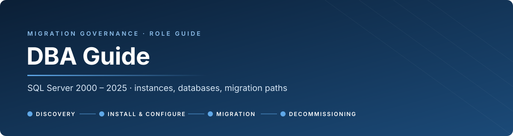
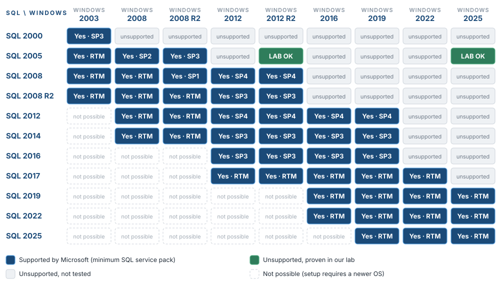
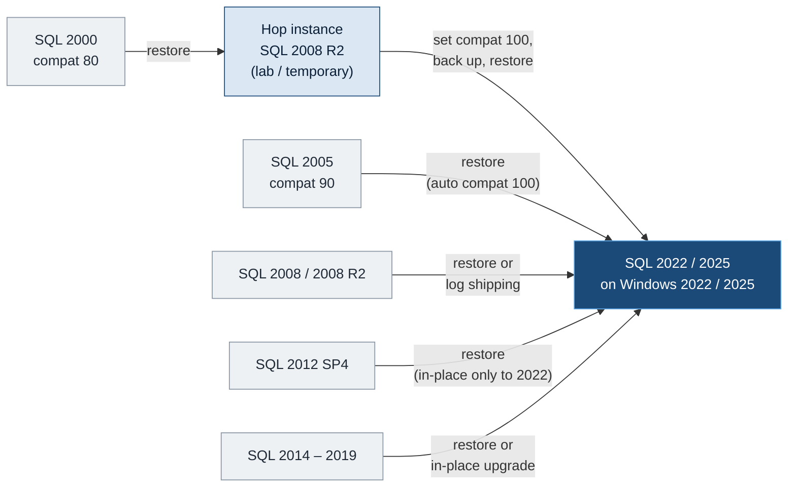
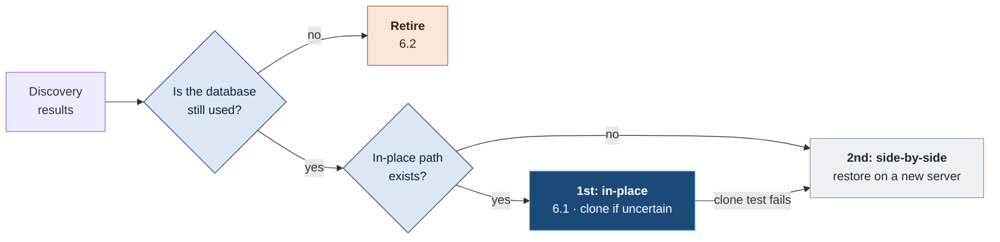

<p align="center">
  
</p>

<p align="center">
  <a href="#1-supported-vs-works-but-not-supported"><b>Supported vs works</b></a> &nbsp;·&nbsp;
  <a href="#2-your-responsibilities"><b>Responsibilities</b></a> &nbsp;·&nbsp;
  <a href="#3-hand-offs-with-the-sysadmin"><b>Hand-offs</b></a> &nbsp;·&nbsp;
  <a href="#4-sql-server-on-windows-server"><b>SQL × Windows</b></a> &nbsp;·&nbsp;
  <a href="#5-migration-paths"><b>Migration paths</b></a> &nbsp;·&nbsp;
  <a href="#6-options-after-discovery"><b>In-place · retire</b></a> &nbsp;·&nbsp;
  <a href="#7-audit-logging"><b>Audit logging</b></a> &nbsp;·&nbsp;
  <a href="#8-tasks-by-phase"><b>Tasks by phase</b></a> &nbsp;·&nbsp;
  <a href="README.md"><b>Big picture</b></a>
</p>

<p align="center"><sub>Role guide for DBAs · the <a href="README.md">governance guide</a> is the big picture; this page is <b>what the DBA owns</b> · the sysadmin side is in the <a href="SYSADMIN.md">Sysadmin guide</a></sub></p>

> [!IMPORTANT]
> **The DBA owns everything inside the SQL Server instance:** engine, databases, logins, jobs, packages, and the data's integrity before and after the move.
> **The sysadmin owns everything around it:** the server, the OS, disks, network, files and protocols. You work together, but each side signs for its own part.

<p align="center"></p>

## 1. Supported vs works but not supported

These two words tell you who carries the risk. Whether a clone is needed depends on something else: **how certain the path is** ([when to clone](README.md#when-to-clone)).

| | **SUPPORTED** | **WORKS, BUT NOT SUPPORTED** |
|---|---|---|
| **Meaning** | **Microsoft lists the combination.** SQL version, service pack and Windows version are in Microsoft's compatibility matrix | **It runs, and we proved it in the lab, but Microsoft doesn't list it** (or lists it as "not supported") |
| **Fixes and security updates** | **Yes.** Bugs and vulnerabilities in this combination get fixed | **No.** If it breaks because of the combination, nobody fixes it |
| **Microsoft support case** | **Accepted** | **Can be refused.** The first answer is "move to a supported configuration" |
| **Approval** | **Normal gate** | **Normal gate. No exception, not a blocker.** If the path is **uncertain**, it runs on a cloned VM first |
| **Can it be the end state?** | **Yes** | **No. A step on the way to a newer, supported SQL version** |
| **Who carries the risk** | Shared with the vendor | **Us alone**, which is why an uncertain path is proven on a clone first |

> [!IMPORTANT]
> **Every migration ends on a newer, supported SQL version.** An unsupported step on the way is allowed. **Clone only when the path is uncertain:** not yet done in the lab or the program, something unusual found on this server, or you're not confident. A proven path goes straight to production, with a snapshot before each step ([governance §2.7](README.md#when-to-clone)).

**On the DBA side, it typically looks like this:**
- **SQL 2005 still running on Windows Server 2012 R2 or 2025.** Our lab ran it there after in-place OS upgrades, with a clean `DBCC CHECKDB`, crash recovery and fault injection passed. **But** the engine is out of support, the combination is unsupported, and SQL 2005 only does **TLS 1.0** at login. Clients need a TLS 1.0 exception too ([governance §2.6](README.md#26-legacy-protocols-and-insecure-settings)).
- **SQL 2005 on Windows Server 2008 (not R2).** **The combination was supported** (SQL 2005 SP2 or later), **but both products are out of support**: SQL 2005 since 2016, Windows 2008 since 2020. There are no fixes for either, so it's in the same risk position as an unsupported combination. TLS 1.0 at login applies here too. The way out:
  - **Data:** the databases restore **directly** on SQL 2022 or 2025, which is **supported** (5.1).
  - **OS in place, if the server is x64:** 2008 → 2012 → 2016 → 2025, with SQL 2005 kept running (form A, 6.1). **Not tested in our lab**: the lab chain started from 2008 R2. Clone first.
  - **If the server is 32-bit (x86):** there's **no in-place path**, because Windows 2012 and later are x64 only. Side-by-side.
- **SQL 2016 on Windows Server 2022, or SQL 2017 on Windows Server 2025.** It installs and runs, **but Microsoft lists both as "not supported"**. Pick SQL 2019 or later for those OS versions.
- **A restore from SQL 2005 to SQL 2022 or 2025 is supported.** The database is raised to compatibility level 100 automatically. This is the **supported** way off SQL 2005; no extra hop is needed.

<p align="center"></p>

## 2. Your responsibilities

**A** = accountable (signs for it), **R** = does the work, **C** = consulted. The full RACI with every role is in the [governance guide §2.3](README.md#23-raci-for-all-phases).

| Phase | DBA is **A** for | DBA is **R** for | DBA is **C** for |
|---|---|---|---|
| **1 · Discovery** | SQL discovery script and output; SQL flags | Connection and activity capture inside SQL; dependency list (SQL side) | Server discovery; legacy protocols (TLS for SQL clients) |
| **2 · Install & configure** | SQL install and configuration on the target | Smoke test (SQL side) | Server build (disk layout, service accounts) |
| **3 · Migration** | **Everything SQL after the OS hand-off:** SQL upgrade or new instance, **data migration and validation**, app test with the app owner, up to Gate 3 | Rehearsal (on a clone if uncertain); cut-over and rollback plan (SQL side) | The OS in-place upgrade (done by the sysadmin); DNS / alias switch timing |
| **4 · Decommissioning** | Instance decommissioning: databases offline, final backups, logins disabled | Quiet-period monitoring inside SQL | Server removal |

**What the DBA signs at each gate**

| Gate | DBA signature covers |
|---|---|
| **Gate 1** | SQL summary reviewed; every SQL RED flag decided; migration path chosen (section 5) |
| **Gate 2** | Instance built to standard; logins, jobs, linked servers scripted; backup and restore proven on the target |
| **Gate 3** | Data validated (row counts, CHECKDB, key reports); jobs running; first backup and restore on the target |
| **Gate 4** | Databases offline then final backup kept; instance stopped; SQL licence released |

<p align="center"></p>

## 3. Hand-offs with the sysadmin

**Three hand-off points** ([governance §2.2](README.md#22-roles)):
1. **After Discovery (Gate 1):** OS path and SQL path agreed together.
2. **OS hand-off:** the sysadmin finishes the OS in-place upgrade and hardening, then hands the server over. **From then on, the DBA is responsible** up to Gate 3.
3. **Before decommissioning:** the DBA confirms the databases are offline and backed up; then the sysadmin removes the server.

Most delays happen **between** the two roles. Ask early, using this list.

| DBA needs from the sysadmin | Sysadmin needs from the DBA |
|---|---|
| Target server built, with **disk layout for SQL**: data, log, tempdb and backup volumes, 64 KB allocation unit | **SQL port(s)** and Browser need, for the firewall rules |
| **Service accounts** or gMSAs created, passwords in the vault, with **instant file initialization** and **lock pages in memory** rights | **AV exclusions** for data, log and backup files and `sqlservr.exe` |
| Backup agent installed; backup share reachable | **Backup** schedule and retention for the agent |
| Firewall rules for 1433 / named instance ports | Which **apps and servers connect** to SQL (from the capture), for the dependency list |
| **DNS alias switch** at the agreed time in cut-over | **Go / no-go** on the SQL side before the DNS switch |
| TLS certificate for SQL encryption | **TLS level** needed by SQL clients (legacy 2005 clients need TLS 1.0) |
| Server kept powered on during the quiet period | Confirmation that **databases are offline** before power-off |

<p align="center"></p>

## 4. SQL Server on Windows Server

<p align="center"></p>

**How to read it**

- **Yes · SP4** = **supported by Microsoft**, with at least that SQL service pack. Source: Microsoft, [SQL Server and Windows compatibility matrix](https://learn.microsoft.com/en-us/troubleshoot/sql/general/use-sql-server-in-windows) (KB 2681562, updated 2026-08-05). Windows 2003, 2008 and 2008 R2 aren't in that article any more. Those cells come from each SQL version's archived hardware and software requirements; check the exact minimum service pack there before relying on it.
- **LAB OK** = **not supported, but proven in our lab:** SQL 2005 SP4 kept running through in-place OS upgrades 2008 R2 → 2012 R2 → 2025. See [section 5.3](#53-lab-proven-interim-path-keep-sql-upgrade-the-os-under-it).
- **unsupported** = Microsoft doesn't support it and we haven't tested it. Don't plan on it.
- **not possible** = the SQL version needs a newer Windows; setup won't install it there.

> [!NOTE]
> Every SQL version up to **2016** is already **out of support itself**, wherever it runs ([governance §1](README.md#support-status-what-to-migrate-first)). A "supported" cell for those means the **combination** was supported, not that the product still gets updates.

**Targets to choose for a new build**

| Target Windows | Supported SQL to install | Recommended |
|---|---|---|
| **Windows Server 2025** | SQL 2019, 2022, 2025 | **SQL 2022 or 2025** |
| **Windows Server 2022** | SQL 2017, 2019, 2022, 2025 | **SQL 2022 or 2025** |
| Windows Server 2019 | SQL 2012 SP4 to 2025 | Only if the OS is imposed; SQL 2022 |

<p align="center"></p>

## 5. Migration paths

### 5.1 From each source version to SQL 2022 / 2025



| Source | **Supported** path to SQL 2022 / 2025 | Minimal-downtime option | Watch out for |
|---|---|---|---|
| **SQL 2000** (compat 80) | **Two hops.** Restore on a **temporary SQL 2008 R2 instance**, raise to compat 100, back up, restore on 2022 / 2025 | None: plan a full outage | **DTS packages** need a rewrite to SSIS. No direct path exists |
| **SQL 2005** (compat 90) | **Direct backup / restore** on 2022 or 2025, which raises the database to compat 100 | Differential + log backups restored before cut-over | No log shipping from 2005 to 2022/2025. Old clients may need TLS 1.0 on the **source** until cut-over |
| **SQL 2008 SP3+ / 2008 R2 SP2+** | **Direct backup / restore** | **Log shipping** to 2022 / 2025 is supported | Once the new server is primary, the old one can't receive changes back. Rollback = the untouched source |
| **SQL 2012 SP4** | Backup / restore to 2022 or 2025. **In-place upgrade only to 2022**, and only if the OS supports SQL 2022 | Log shipping, or AG (Enterprise) | In-place: the OS must be Windows 2016+, and SQL 2012 often sits on 2012 R2 |
| **SQL 2014 SP3 / 2016 SP3** | Backup / restore, or **in-place upgrade** to 2022 / 2025 | Log shipping, AG | In-place to 2025 needs Windows 2019+ under it |
| **SQL 2017 / 2019** | Backup / restore, or in-place upgrade to 2022 / 2025 | Log shipping, AG, distributed AG | SQL 2017 isn't supported on Windows 2025 |

Sources: Microsoft, *Supported version and edition upgrades* for [SQL Server 2022](https://learn.microsoft.com/en-us/sql/database-engine/install-windows/supported-version-and-edition-upgrades-2022) and [SQL Server 2025](https://learn.microsoft.com/en-us/sql/database-engine/install-windows/supported-version-and-edition-upgrades-2025): direct migration from compatibility level 90+; in-place upgrade from 2012 SP4 (to 2022) or 2014 SP3 (to 2025); log shipping from 2008 SP3 / 2008 R2 SP2.

> [!WARNING]
> **A restore upgrades the database one way.** A backup taken on SQL 2022 can't be restored on the old version. **The rollback is always the untouched source instance**, kept read-only and available until Gate 3.

### 5.2 Choosing the method

**In-place first, whenever a supported path exists. Side-by-side second** ([governance §3.1](README.md#31-choose-the-method)). Clone first only when the path is uncertain ([when to clone](README.md#when-to-clone)).

| Situation | Method |
|---|---|
| **A supported in-place SQL path exists** (to 2022 from 2012 SP4+, to 2025 from 2014 SP3+) and the OS supports the target SQL | **1st choice: in-place SQL upgrade** (supported, so normally no clone). Rollback = the VM snapshot |
| The OS is upgraded in place, but the SQL version can't be upgraded in place (SQL 2005, 2008, 2008 R2) | **Keep the server, change the instance:** install a new SQL 2022 / 2025 instance on the upgraded server, then restore the databases into it (5.1). Clone first |
| **2nd choice: side-by-side**, small or medium database, outage window of a few hours | **Full backup → restore**, then a final differential or log backup at cut-over |
| Large database, short window, source 2008 SP3+ | **Log shipping**, then a final log backup and recovery at cut-over |
| Many databases, logins and jobs on one instance | **dbatools** from the admin workstation: `Copy-DbaLogin`, `Copy-DbaAgentJob`, `Copy-DbaLinkedServer`, `Copy-DbaDatabase` |
| SQL 2000 | Hop instance (5.1) and a full outage |
| The app can't move yet, but the OS must leave 2008 R2 | **Interim step:** the lab path in 5.3. The sysadmin does the OS part; the DBA takes over at the OS hand-off |

### 5.3 Lab-proven interim path: keep SQL, upgrade the OS under it

**NOT SUPPORTED. Proven in our lab. A step on the way to a newer SQL version.** Because it's lab-proven, a clone is needed only if Discovery found something unusual on the server ([when to clone](README.md#when-to-clone)).

In the lab, a SQL Server 2005 SP4 instance with a live application stayed in place while the sysadmin upgraded Windows **2008 R2 SP1 → 2012 R2 → 2025** in place. Nothing was reinstalled or restored. The OS upgrade itself is the sysadmin's runbook ([Sysadmin guide §5](SYSADMIN.md#5-windows-in-place-upgrade-paths)).

| Lab check (on Windows 2025) | Result |
|---|---|
| SQL services, logins, databases after each OS hop | **Kept**, untouched. `@@VERSION` shows the wrong Windows name (cosmetic) |
| Service stop / start | Stopped in about 3 s, restarted cleanly; app reconnected |
| Hard kill of `sqlservr.exe` | Crash recovery in **about 1 s**; `DBCC CHECKDB` clean |
| Disk full | Reads fine; writes failed with the correct errors (9002, 3202); full recovery |
| Memory pressure (to about 900 MB free) | Kept answering; full recovery |
| **Weakness found** | **No service recovery actions:** after a crash, SQL stayed down. **Fixed** with `sc failure` (below), and re-tested: back in 13.5 s with no manual action |

Full details: [lab runbook](../legacy-migration/README.md) and [stability showcase](../legacy-migration/STABILITY.md).

**Conditions for using it in production**
- [ ] **Clone first if this server is uncertain** ([when to clone](README.md#when-to-clone)); otherwise a snapshot before each OS step. Steps and timings recorded on the server page
- [ ] Server **LAN-only and firewalled**; no internet access
- [ ] Service recovery set on every SQL service:
  ```bat
  sc failure MSSQLSERVER reset= 86400 actions= restart/5000/restart/10000/restart/30000
  sc failure SQLBrowser  reset= 86400 actions= restart/5000/restart/10000/restart/30000
  ```
- [ ] TLS 1.0 exception for the SQL clients, if any client still needs it
- [ ] **Exit plan with a date:** restore the databases on a supported SQL version (2005 → 2022/2025 is direct, 5.1). This can be a new SQL 2022 or 2025 instance on the same upgraded server, or a new server.

> [!NOTE]
> Moving the databases to a new SQL 2022 instance **on the same upgraded server** hasn't been tested in the lab yet. It's the next lab test before the end-state step is offered as a standard path.

<p align="center"></p>

## 6. Options after Discovery

Discovery ends with **one of three options** for each server or database, decided at Gate 1 ([governance §1.10](README.md#110-disposition-migrate-consolidate-or-retire)):



### 6.1 In-place upgrade, step by step

> [!IMPORTANT]
> **The OS in-place upgrade is done by the sysadmin** ([Sysadmin §6.1](SYSADMIN.md#61-in-place-upgrade-step-by-step)). The DBA's part during the OS work is small: full backups before the first hop, and a quick SQL check after each hop. **When the sysadmin hands the server over (the OS hand-off), the DBA becomes responsible** for the rest: SQL to a newer version, data validation, and the app test with the app owner, up to Gate 3.

"In-place" means **the server stays**. For the DBA it takes one of three forms, depending on the SQL version:

| Form | When | What the DBA does |
|---|---|---|
| **A. OS upgraded under SQL** | **The sysadmin** upgrades Windows in place ([Sysadmin §6.1](SYSADMIN.md#61-in-place-upgrade-step-by-step)) | Backups before, a quick SQL check after each hop; **take over at the OS hand-off** |
| **B. SQL upgraded in place** | A **supported** SQL upgrade path exists: to **2022** from 2012 SP4, 2014 SP3, 2016 SP3, 2017, 2019; to **2025** from 2014 SP3 onwards. **And** the OS supports the target SQL | Run SQL setup in upgrade mode |
| **C. New instance on the same server** | SQL can't be upgraded in place (**SQL 2005, 2008, 2008 R2**), but the server stays | Install a new SQL 2022 / 2025 instance next to the old one; restore the databases into it (5.1) |

Usual combination for old servers: **A, then C**. The OS goes 2008 R2 → 2012 R2 → 2025 with SQL 2005 kept running (A, lab-proven), then the databases move to a new SQL 2022 instance on the same server (C), and the SQL 2005 instance is removed.

**Steps for each form** (on a clone first only if the path is uncertain):

| # | A. OS upgraded under SQL | B. SQL upgraded in place | C. New instance on the same server |
|:-:|---|---|---|
| **1** | Full backups of **all** databases, system databases included; script logins and jobs | Full backups; check the prerequisites: no pending restart, Agent account in sysadmin, supported edition path | Full backups; script logins (with SIDs), jobs, linked servers |
| **2** | Note the baseline: version, databases, logins, jobs, row counts of key tables | Run **Data Migration Assistant** from the admin workstation for breaking changes | Install the new instance (named, or default after the old one is removed); standard configuration |
| **3** | The sysadmin runs the OS hop | Run SQL **setup in upgrade mode** | Restore the databases; recreate logins, jobs and linked servers (dbatools) |
| **4** | After each hop: quick check (services up, connection works). **After the OS hand-off:** error log, `DBCC CHECKDB`, app test | After setup: error log, `DBCC CHECKDB`, `UPDATE STATISTICS`, app test | `DBCC CHECKDB`, orphaned users fixed, app connection string or alias pointed to the new instance, app test |
| **5** | Set **service recovery actions** (`sc failure`, lab finding) | Compatibility levels **unchanged**; raise them later, after validation, with Query Store on | Old instance stopped and kept as the rollback until Gate 3, then uninstalled |
| **Rollback** | VM snapshot before the hop | **VM snapshot**; an in-place SQL upgrade can't be undone otherwise | The old instance, untouched |

> [!NOTE]
> **Form C hasn't been tested in our lab yet** (see the note in 5.3), so it's **uncertain**: run it on a clone first until it has worked once.

### 6.2 Retire: when Discovery shows a database isn't used

If nobody and nothing uses a database or a whole instance any more, it **isn't migrated**. It goes straight to Phase 4 on the **retire-only path** ([governance, retire-only path](README.md#retire-only-path)). A server can also be split: some databases migrate, the others retire.

**Evidence the DBA brings to Gate 1:**

| Check | "Not used" looks like |
|---|---|
| Connection capture during the Discovery week | **No user connections** to the database, apart from maintenance and backup |
| `sys.dm_db_index_usage_stats` (2005+) | **No reads or writes** since the last restart, **and the instance has been up for a long time** (the stats reset on restart) |
| Login auditing / error log | No successful logins by application accounts |
| Agent jobs | Only maintenance jobs touch it; no business jobs, or their output isn't used |
| Linked servers and cross-database queries | **No other instance or database** reads from it (check the other instances' linked servers) |
| SSRS / SSIS | No reports or packages use it as a data source |
| Size and last write | Data and log files not growing; last full backup the same size for months |

> [!IMPORTANT]
> **The DBA brings the evidence; the app owner decides.** Retention rules may still require the data: **retire doesn't mean delete**. The app owner, or the data owner, decides whether the database is archived, handed over or deleted.

**DBA tasks on the retire-only path:**
- [ ] Final **full backup** of each database, kept per retention, with a **restore test**
- [ ] Set the database **offline** (not dropped), so it can come back in minutes
- [ ] During the **scream test** (at least 4 weeks, including a month-end): watch the error log for failed logins to the offline database. Any attempt is a missed dependency
- [ ] If someone is affected: bring it back online, record the dependency, and go back to Gate 1
- [ ] If nobody is affected: carry out the data decision (archive copy kept, or drop under the retention policy), then stop and uninstall the instance if nothing else is on it, and release the SQL licence
- [ ] Confirm to the sysadmin that the server can be powered off

<p align="center"></p>

## 7. Audit logging

### 7.1 What an audit log is

An **audit log** is a record of **who did what, when, and from where** on the instance, kept so it can be checked later. For SQL Server it covers four kinds of events:

| Kind | Examples | Why it matters |
|---|---|---|
| **Logins** | Successful and failed logins: login name, client host, application, time | Who uses the instance; brute-force attempts; **dependency discovery** during migration |
| **Security changes** | Logins created or dropped, role membership, `GRANT` / `DENY` / `REVOKE`, password changes | Privilege escalation; Cyber and audit requirements |
| **Schema changes (DDL)** | `CREATE` / `ALTER` / `DROP` of tables, procedures, databases | Unplanned changes; troubleshooting after a release |
| **Data access (DML)** | `SELECT` / `INSERT` / `UPDATE` / `DELETE` on sensitive tables | Compliance for personal or financial data. **Costly**: only on the tables that need it |

An audit log is **not** the transaction log (that's for recovery), and **not** the error log, although the error log can hold login events (7.3).

### 7.2 What each version supports

| Version | Native **SQL Server Audit** | Other built-in options |
|---|---|---|
| **SQL 2000** | **None** | SQL Trace (server-side), C2 audit mode, login auditing to the error log, DML triggers |
| **SQL 2005** | **None** | Same as 2000, plus the **default trace**, **DDL triggers**, **logon triggers** (SP2+), event notifications, Common Criteria compliance (SP2, Enterprise) |
| **SQL 2008 / 2008 R2** | **Enterprise only** (server and database level) | Standard edition: the 2005 options, plus Extended Events |
| **SQL 2012 / 2014** | **Server level: all editions.** Database level: Enterprise only | Audit filtering, user-defined audit events, Extended Events |
| **SQL 2016 SP1 – 2025** | **Server and database level: all editions** | Extended Events; temporal tables (data history, 2016+); ledger (tamper-evident tables, 2022+) |

> [!IMPORTANT]
> **On the target (SQL 2022 / 2025), use SQL Server Audit.** It's built in, cheap, and covers all four kinds. The workarounds in 7.3 are for the **source** servers until they're migrated, and for discovery.

### 7.3 Options on versions without SQL Server Audit

Use **several light options together**. None of them alone covers everything, and none is as complete as SQL Server Audit.

| Option | Versions | Covers | Cost and risks |
|---|---|---|---|
| **1. Login auditing to the error log** | 2000+ | Successful and failed logins | Very low. The error log grows: **recycle it daily and keep 30 files** |
| **2. Default trace** | 2005+ | Object created, altered, dropped; logins and users added; some permission changes; DBCC; server config changes | **On by default**, almost free. Only 5 files × 20 MB that roll over: **copy them off regularly** |
| **3. Server-side SQL Trace** (audit events only) | 2000+ | Logins, failed logins, security changes, DDL. DML on chosen tables possible | Low when filtered to audit events. **Never use the Profiler GUI** for this. Must be **restarted after a SQL restart** (startup procedure) |
| **4. DDL triggers** | 2005+ | All DDL, with the full statement (`EVENTDATA()`) into an audit table | Low. **A broken trigger blocks all DDL**: test on the clone |
| **5. Logon trigger** | 2005 SP2+ | Logins, with host and application | **A broken logon trigger locks everyone out.** Recovery needs the DAC. Use only if 1 and 3 aren't enough |
| **6. DML triggers** on sensitive tables | 2000+ | Data changes on those tables | Adds cost to every write; not for `SELECT` |
| **7. C2 audit mode** / Common Criteria | 2000+ / 2005 SP2 Ent. | Everything | **Heavy.** The instance **stops if the audit disk fills**. Last resort only |
| **8. Network and OS side** (sysadmin) | Any | Who connects to the SQL port, from where | Windows Security log, firewall logs; no SQL detail |

**Recommended set for a legacy source server:** **1 + 2 + 3**, with the files **copied off the server** every day (to the log server or SIEM), so they survive a disk failure and are harder to tamper with. Add **4** where schema changes matter.

> [!WARNING]
> **None of these is tamper-proof.** A sysadmin on the instance can stop a trace, disable a trigger or delete files. That's why the files are copied off the server daily, and why the target uses SQL Server Audit. On the decision log, record what the legacy server has as a **compensating control**, not as a full audit.

<details>
<summary><b>Scripts: login auditing, error-log retention, default trace (2005+)</b></summary>

```sql
-- 1. Login auditing: both failed and successful logins (3 = both). Takes effect after a SQL restart.
EXEC xp_instance_regwrite N'HKEY_LOCAL_MACHINE',
     N'Software\Microsoft\MSSQLServer\MSSQLServer', N'AuditLevel', REG_DWORD, 3;

-- Keep 30 error logs, and recycle daily (add sp_cycle_errorlog to a daily Agent job)
EXEC xp_instance_regwrite N'HKEY_LOCAL_MACHINE',
     N'Software\Microsoft\MSSQLServer\MSSQLServer', N'NumErrorLogs', REG_DWORD, 30;
EXEC sp_cycle_errorlog;
```

```sql
-- 2. Read the default trace (2005+)
DECLARE @path nvarchar(260);
SELECT @path = REVERSE(SUBSTRING(REVERSE(path), CHARINDEX('\', REVERSE(path)), 260)) + N'log.trc'
FROM sys.traces WHERE is_default = 1;

SELECT t.StartTime, e.name AS event, t.LoginName, t.HostName, t.ApplicationName,
       t.DatabaseName, t.ObjectName
FROM fn_trace_gettable(@path, DEFAULT) AS t
JOIN sys.trace_events AS e ON e.trace_event_id = t.EventClass
ORDER BY t.StartTime DESC;
```

</details>

<details>
<summary><b>Script: server-side audit trace that restarts with SQL (2000 and 2005)</b></summary>

```sql
USE master;
GO
-- Starts a rollover trace of audit events only. Marked as a startup procedure below.
CREATE PROCEDURE dbo.usp_StartAuditTrace
AS
BEGIN
    DECLARE @id int, @on bit, @file nvarchar(245), @size bigint;
    SET @on = 1;
    SET @size = 100;                         -- MB per file
    SET @file = N'D:\SQLAudit\audit_' + CONVERT(nvarchar(8), GETDATE(), 112)
              + N'_' + REPLACE(CONVERT(nvarchar(8), GETDATE(), 108), ':', '');
    -- 2 = TRACE_FILE_ROLLOVER. On SQL 2005+ you can add @filecount = 50 to cap the number of files.
    EXEC sp_trace_create @id OUTPUT, 2, @file, @size, NULL;

    -- Events: 14 Login, 20 Login failed, 102 DB scope GDR, 103 Object GDR,
    -- 104 Add login, 105 Login GDR, 106 Login change property, 107 Login change password,
    -- 108 Add login to server role, 109 Add DB user, 110 Add member to DB role,
    -- 46 Object created, 47 Object deleted, 164 Object altered
    DECLARE @events TABLE (e int);
    INSERT @events SELECT 14 UNION ALL SELECT 20 UNION ALL SELECT 102 UNION ALL SELECT 103
         UNION ALL SELECT 104 UNION ALL SELECT 105 UNION ALL SELECT 106 UNION ALL SELECT 107
         UNION ALL SELECT 108 UNION ALL SELECT 109 UNION ALL SELECT 110
         UNION ALL SELECT 46 UNION ALL SELECT 47 UNION ALL SELECT 164;

    -- Columns: 1 TextData, 6 NTUserName, 8 HostName, 10 ApplicationName, 11 LoginName,
    -- 12 SPID, 14 StartTime, 21 EventSubClass, 34 ObjectName, 35 DatabaseName
    DECLARE @cols TABLE (c int);
    INSERT @cols SELECT 1 UNION ALL SELECT 6 UNION ALL SELECT 8 UNION ALL SELECT 10
         UNION ALL SELECT 11 UNION ALL SELECT 12 UNION ALL SELECT 14 UNION ALL SELECT 21
         UNION ALL SELECT 34 UNION ALL SELECT 35;

    DECLARE @e int, @c int;
    DECLARE ec CURSOR LOCAL FAST_FORWARD FOR SELECT e, c FROM @events CROSS JOIN @cols;
    OPEN ec;
    FETCH NEXT FROM ec INTO @e, @c;
    WHILE @@FETCH_STATUS = 0
    BEGIN
        EXEC sp_trace_setevent @id, @e, @c, @on;
        FETCH NEXT FROM ec INTO @e, @c;
    END
    CLOSE ec; DEALLOCATE ec;

    EXEC sp_trace_setstatus @id, 1;          -- start
END
GO
EXEC sp_procoption N'dbo.usp_StartAuditTrace', 'startup', 'true';
EXEC dbo.usp_StartAuditTrace;
```

Create `D:\SQLAudit` first, writable by the SQL service account, on a volume that **isn't the data or log volume**. A daily Agent job or scheduled task copies the closed `.trc` files to the log server. Read them with `fn_trace_gettable`. Test on the clone first.

</details>

<details>
<summary><b>Target: SQL Server Audit on SQL 2022 / 2025</b></summary>

```sql
USE master;
CREATE SERVER AUDIT MigrationAudit
    TO FILE (FILEPATH = N'D:\SQLAudit\', MAXSIZE = 256 MB, MAX_ROLLOVER_FILES = 50)
    WITH (ON_FAILURE = CONTINUE);
ALTER SERVER AUDIT MigrationAudit WITH (STATE = ON);

CREATE SERVER AUDIT SPECIFICATION MigrationAuditSpec
    FOR SERVER AUDIT MigrationAudit
    ADD (FAILED_LOGIN_GROUP),
    ADD (SUCCESSFUL_LOGIN_GROUP),
    ADD (SERVER_ROLE_MEMBER_CHANGE_GROUP),
    ADD (DATABASE_ROLE_MEMBER_CHANGE_GROUP),
    ADD (SERVER_PERMISSION_CHANGE_GROUP),
    ADD (DATABASE_PERMISSION_CHANGE_GROUP),
    ADD (SERVER_PRINCIPAL_CHANGE_GROUP),
    ADD (DATABASE_PRINCIPAL_CHANGE_GROUP),
    ADD (SCHEMA_OBJECT_CHANGE_GROUP),
    ADD (DATABASE_OBJECT_CHANGE_GROUP),
    ADD (AUDIT_CHANGE_GROUP)
    WITH (STATE = ON);

-- Read it
SELECT event_time, action_id, succeeded, server_principal_name, client_ip,
       application_name, database_name, object_name, statement
FROM sys.fn_get_audit_file(N'D:\SQLAudit\*.sqlaudit', DEFAULT, DEFAULT)
ORDER BY event_time DESC;
```

Add a **database audit specification** for `SELECT` / `UPDATE` on sensitive tables only where compliance requires it.

</details>

<p align="center"></p>

## 8. Tasks by phase

### Phase 1 · Discovery

Details and queries per version: [governance §1.6 – 1.8](README.md#16-sql-instance).

- [ ] Run the SQL discovery script (yours or the reference one) from the **admin workstation**, using dbatools where possible
- [ ] Instance: version, edition, SP, collation, service accounts, port, configuration, trace flags
- [ ] Databases: size, compat level, recovery model, page verify, last CHECKDB, last backup
- [ ] Logins, orphaned users, jobs and their owners, linked servers, DTS / SSIS / SSRS, Database Mail, encryption keys
- [ ] **Monthly and quarterly Agent jobs** listed, each with an owner
- [ ] Connection capture inside SQL for the Discovery week, plus login auditing
- [ ] **Migration path chosen per database** (section 5), with **supported** or **works, not supported**, and **proven** or **uncertain (clone)**, written next to it
- [ ] SQL flags written to the summary file; sign the Gate 1 part

### Phase 2 · Install & configure

- [ ] Supported SQL version on the target OS (section 4), at the latest CU
- [ ] Collation matches the source, or the change is documented
- [ ] Memory, MAXDOP, cost threshold for parallelism, tempdb files to standard
- [ ] Service accounts, SPNs, static port; **service recovery actions** set (lab finding)
- [ ] Backups, integrity checks and index maintenance jobs from the standard solution
- [ ] Logins scripted with their SIDs and password hashes (`Copy-DbaLogin` or `sp_help_revlogin`), **disabled** until cut-over
- [ ] Linked servers with non-personal credentials; Database Mail; operators and alerts
- [ ] **Backup → restore tested** on the target

### Phase 3 · Migration

- [ ] **Take over at the OS hand-off** (in-place) and record it on the server page. From here the DBA is responsible up to Gate 3
- [ ] **Rehearsal**, timed: on a clone if the path is uncertain ([when to clone](README.md#when-to-clone)), otherwise on a test instance. Record the duration on the server page
- [ ] Source set **read-only** (or app stopped) before the final backup
- [ ] Restore; fix orphaned users (`ALTER USER … WITH LOGIN = …`); enable logins; enable jobs
- [ ] `DBCC CHECKDB`, then `UPDATE STATISTICS` with `FULLSCAN` on key tables
- [ ] Page verify set to **`CHECKSUM`**
- [ ] Row counts and key reports compared with the source
- [ ] **Compatibility level raised only after validation**, one database at a time. Enable **Query Store** first, so plan regressions are visible
- [ ] First backup on the target **and a restore test**
- [ ] Go / no-go for the DNS switch, given to the sysadmin

### Phase 4 · Decommissioning

- [ ] Source databases set **offline** (not dropped) for the quiet period
- [ ] Watch for login attempts on the old instance during the quiet period; any attempt is a missed dependency
- [ ] Final full backup of every database, kept per retention, with a restore test
- [ ] Instance stopped and services disabled; SQL licence released
- [ ] Confirm to the sysadmin that the server can be powered off

<p align="center"></p>

<p align="center"><sub>DBA guide · part of the <a href="README.md">migration governance</a> · lab evidence in <a href="../legacy-migration/STABILITY.md">legacy-migration</a></sub></p>
