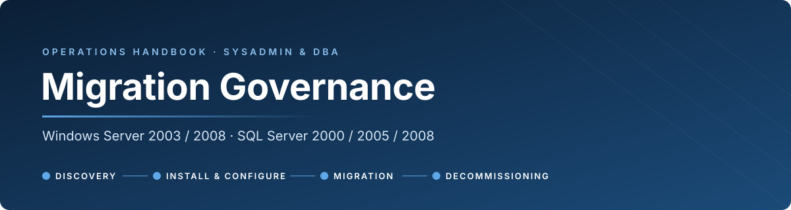
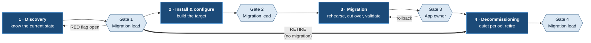
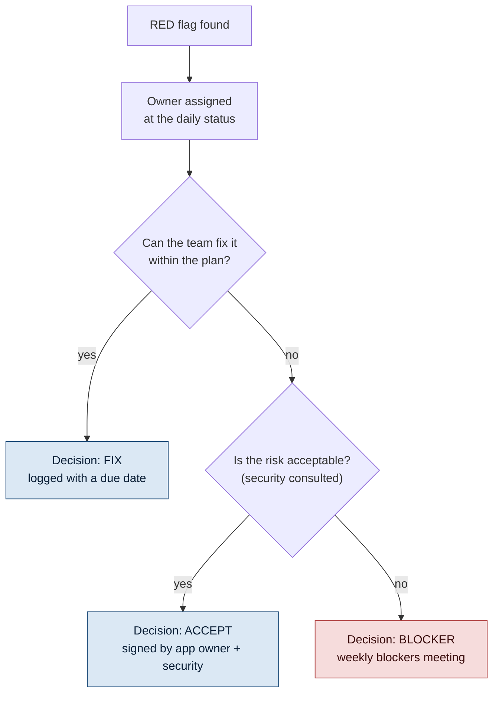
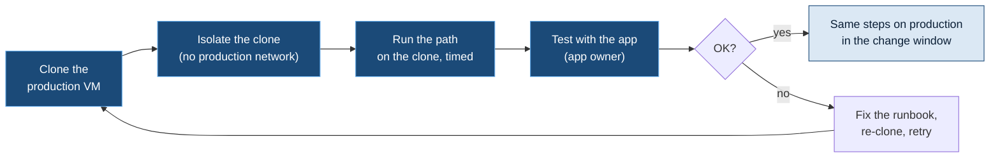
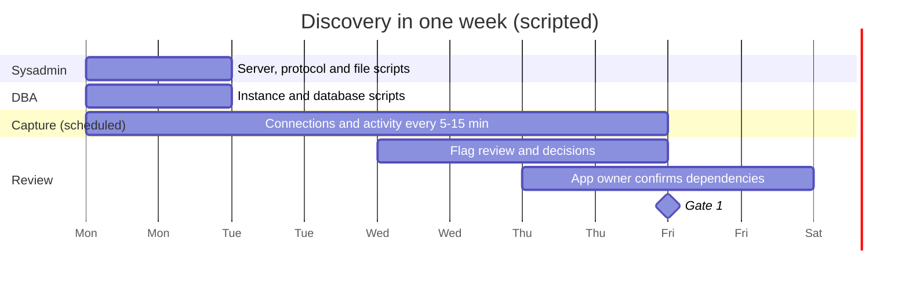
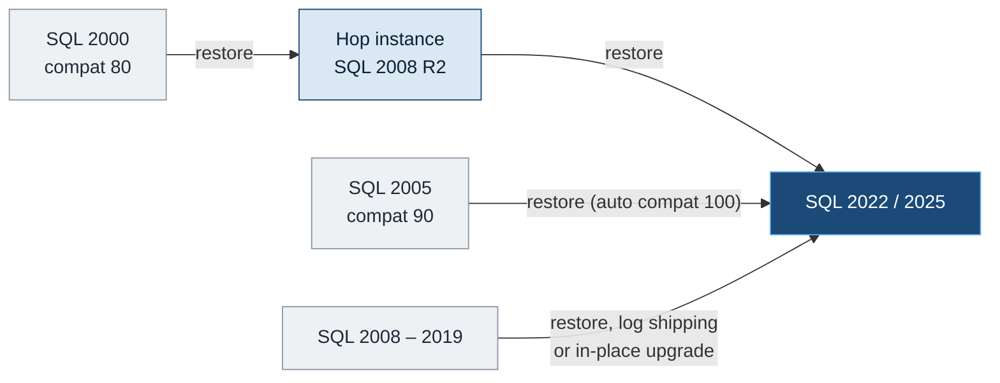
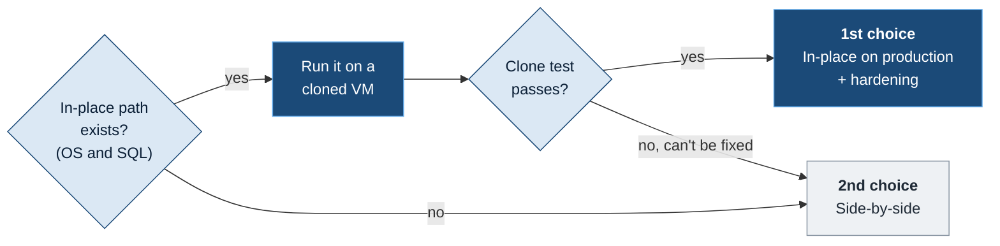
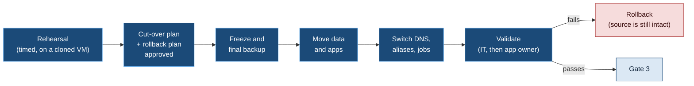
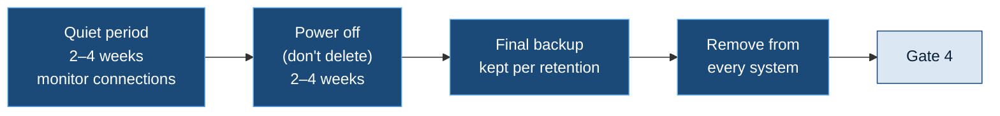
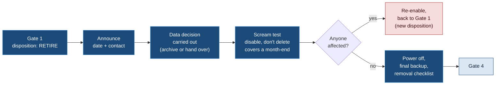

<p align="center">
  
</p>

<p align="center">
  <a href="#1-purpose-and-scope"><b>Scope</b></a> &nbsp;·&nbsp;
  <a href="#2-governance-model"><b>Governance</b></a> &nbsp;·&nbsp;
  <a href="#3-standards"><b>Standards</b></a> &nbsp;·&nbsp;
  <a href="SYSADMIN.md"><b>Sysadmin guide</b></a> &nbsp;·&nbsp;
  <a href="DBA.md"><b>DBA guide</b></a> &nbsp;·&nbsp;
  <a href="SERVER-PAGE-TEMPLATE.md"><b>Server page template</b></a> &nbsp;·&nbsp;
  <a href="SCRIPTS-AND-VSCODE.md"><b>Scripts &amp; VS Code</b></a> &nbsp;·&nbsp;
  <a href="#phase-1--discovery"><b>Discovery</b></a> &nbsp;·&nbsp;
  <a href="#phase-2--install--configure"><b>Install &amp; configure</b></a> &nbsp;·&nbsp;
  <a href="#phase-3--migration"><b>Migration</b></a> &nbsp;·&nbsp;
  <a href="#phase-4--decommissioning"><b>Decommissioning</b></a> &nbsp;·&nbsp;
  <a href="#appendix"><b>Appendix</b></a>
</p>

<p align="center"><sub>Living document · owner: Migration lead · review every quarter, or after every gate that found a gap in this guide</sub></p>

> [!IMPORTANT]
> **Three rules apply to everything below.**
> 1. **No gate, no next phase.** A phase is complete only when its gate checklist is signed.
> 2. **One accountable person per activity.** Many people can do the work; one person owns the result.
> 3. **Collected data is reviewed.** Every output has a reviewer's name and a date.

<p align="center"></p>

## 1. Purpose and scope

This guide sets out **who does what, what to collect, what to decide, and when a phase is done** when legacy Windows servers and SQL Server instances move to supported platforms. It builds on the discovery work and documentation teams already have, and organises them into **checklists, owners and gates**.

| | In scope | Out of scope |
|---|---|---|
| **Platforms** | Windows Server 2003, 2008, 2008 R2, 2012, 2012 R2, 2016, 2019 | Desktop and endpoint migration |
| **Databases** | SQL Server 2000, 2005, 2008, 2008 R2, 2012, 2014, 2016, 2017, 2019 (instances, databases, jobs, packages) | Application code changes (tracked by the app team) |
| **Services** | File shares, FTP, IIS, scheduled jobs, print, legacy protocols | Network redesign and firewall policy (consulted, not owned) |
| **Data** | Live data, unused or stale data, backups, retention | Records-management policy (owned by the data owner) |

### Support status: what to migrate first

<sub>Microsoft extended support end dates. Anything already out of support goes first, starting with the oldest.</sub>

<table>
<tr><th width="50%">Windows Server</th><th width="50%">SQL Server</th></tr>
<tr valign="top"><td>

| Version | Extended support ended / ends |
|---|---|
| 2003 | 2015-07-14 · **out** |
| 2008 / 2008 R2 | 2020-01-14 · **out** |
| 2012 / 2012 R2 | 2023-10-10 · **out** |
| 2016 | 2027-01-12 · **within 3 months** |
| 2019 | 2029-01-09 |

</td><td>

| Version | Extended support ended / ends |
|---|---|
| 2000 | 2013-04-09 · **out** |
| 2005 | 2016-04-12 · **out** |
| 2008 / 2008 R2 | 2019-07-09 · **out** |
| 2012 | 2022-07-12 · **out** |
| 2014 | 2024-07-09 · **out** |
| 2016 | 2026-07-14 · **out** |
| 2017 | 2027-10-12 |
| 2019 | 2030-01-08 |

</td></tr>
</table>

> [!NOTE]
> Servers and instances on extended security updates (ESU) or Azure-hosted extensions still count as **out of support** for planning purposes.

### What this guide brings

Migrations at this scale involve many teams, many servers and a lot of collected data. This guide gives everyone the same reference points:

| Topic | What the guide provides |
|---|---|
| **Scripts** | A shared, versioned set of discovery scripts per role, which everyone can improve |
| **Collected data** | A short **flag summary** for each server, so the key findings are easy to review and act on |
| **Process** | Checklists with owners and exit criteria for each phase |
| **Decisions** | A RACI per phase and a decision log, so it's clear who decides and what was decided |
| **Hand-offs** | Signed gates between phases, so each team knows when it can start |

<p align="center"></p>

## 2. Governance model

### 2.1 Lifecycle and gates



Gate 1 records one **disposition** for each server: **migrate** (Phases 2 → 3 → 4), **consolidate** (move its workload onto an existing server, then Phases 3 → 4), or **retire** (straight to Phase 4, see [Retire-only path](#retire-only-path)).

| # | Phase | Ends when | Gate owner | Typical duration |
|:-:|---|---|---|---|
| **1** | Discovery | The current state is known and reviewed, and every red flag has a decision | Migration lead | **1 week** (scripted collection + 4-day capture + review) |
| **2** | Install & configure | The target is built to standard, hardened and smoke-tested | Migration lead | 1–2 weeks |
| **3** | Migration | A rehearsal is done, cut-over is complete, data is validated and the app owner has accepted | **App owner** | 1–3 weeks |
| **4** | Decommissioning | Quiet period with no connections, final backup taken, server removed everywhere | Migration lead | 4–8 weeks (mostly waiting) |

### 2.2 Roles

This guide is the **big picture**. Sysadmins and DBAs work together, but **each role has its own guide**, setting out what it signs for at each gate and what it needs from the other:

<table>
<tr><td width="50%" align="center"><a href="SYSADMIN.md"><b>Sysadmin guide</b></a><br/><sub>Server, OS, files, network, protocols · Windows in-place paths</sub></td><td width="50%" align="center"><a href="DBA.md"><b>DBA guide</b></a><br/><sub>Instance, databases, data · SQL × Windows matrix · migration paths</sub></td></tr>
</table>

| Role | Owns | Typical person |
|---|---|---|
| **Sysadmin** ([guide](SYSADMIN.md)) | Everything **around** SQL: OS, server, files, network and security discovery; target server build; OS-level cut-over; decommissioning the server | Windows team |
| **DBA** ([guide](DBA.md)) | Everything **inside** the instance: instance and database discovery; SQL build; data migration and validation; decommissioning the instance | DBA team |
| **App owner** | Dependencies, users, business windows, testing, acceptance, decisions about unused data | Business or application team |
| **Migration lead** | Plan, tracking, decision log, gate sign-off (except Gate 3), escalation | Project or team lead |
| **Security / network** | Firewall rules, exceptions for legacy protocols, certificates, risk acceptance | Security and network teams |

### 2.3 RACI for all phases

<sub><b>R</b> does the work · <b>A</b> owns the result (exactly one per row) · <b>C</b> consulted · <b>I</b> informed</sub>

| Activity | Sysadmin | DBA | App owner | Migration lead | Sec / Net |
|---|:-:|:-:|:-:|:-:|:-:|
| ***Phase 1: Discovery*** | | | | | |
| Run the server discovery script | **R/A** | I | | I | |
| Run the SQL discovery script | C | **R/A** | | I | |
| Scheduled connection capture (during the week) | R | R | I | **A** | |
| Discover files, shares and unused data | **R** | | C | A | |
| Discover legacy protocols (SMBv1, FTP, TLS, NTLMv1) | **R** | C | I | A | C |
| Confirm the dependency list | R | R | **A** | C | |
| Review output and decide on flags | R | R | C | **A** | C |
| Decide the disposition (migrate · consolidate · retire) | C | C | **A** | R | I |
| ***Phase 2: Install & configure*** | | | | | |
| Build and harden the target OS | **R/A** | I | | I | C |
| Install and configure SQL | C | **R/A** | | I | |
| Firewall rules, certificates, legacy-protocol exceptions | C | C | I | I | **R/A** |
| Smoke test of the target | R | R | C | **A** | |
| ***Phase 3: Migration*** | | | | | |
| Rehearsal migration | R | R | C | **A** | |
| Cut-over and rollback plan | R | R | C | **A** | C |
| Data migration and validation | C | **R/A** | C | I | |
| Application testing and acceptance | C | C | **R/A** | I | |
| ***Phase 4: Decommissioning*** | | | | | |
| Quiet-period monitoring | **R** | R | I | A | |
| Archiving or deleting unused data | R | R | **A** | C | |
| Server and instance removal from every system | **R** | R | I | **A** | C |

> [!NOTE]
> The Gate 3 sign-off belongs to the **app owner**, not IT. IT says the migration is technically complete; only the business can say it **works**.

### 2.4 Cadence

Governance uses the **existing meetings**; it doesn't add new ones. Each meeting has a defined migration role:

| Meeting | When | Who | Migration topics | Output |
|---|---|---|---|---|
| **Daily status** | Mon–Fri, 15 min | Sysadmins, DBAs, tech lead | Per-server progress, **new RED flags** (owner assigned on the spot), what's ready for a gate | Updated board, flag owners |
| **Tech discussion** | Mon–Thu afternoon, 30 min | Sysadmins, DBAs, tech lead, app owner or security when needed | Review of Discovery summaries, technical decisions on flags, migration method, **gate reviews** for Gates 1, 2 and 4 | Logged decisions, signed gates |
| **Sprint ceremonies** | Per sprint | Agile team | **Planning:** which servers and phases go into the sprint. **Review:** gates signed during the sprint. **Retro:** improvements to the scripts and this guide | Sprint backlog, done items, repository changes |
| **Blockers meeting** | Weekly | PM, tech lead, managers (security when a risk acceptance is on the agenda) | Only flags marked **BLOCKER**, risk acceptances, priorities and resources | Blocker decisions in the decision log |

> [!TIP]
> **Definition of done for a sprint item:** a server's phase is done when its **gate is signed**. Work without a signed gate stays in progress.

<table>
<tr><th></th><th>Monday</th><th>Tuesday</th><th>Wednesday</th><th>Thursday</th><th>Friday</th></tr>
<tr><td><b>Morning</b></td><td>Daily status</td><td>Daily status</td><td>Daily status</td><td>Daily status</td><td>Daily status</td></tr>
<tr><td><b>Afternoon</b></td><td>Tech discussion</td><td>Tech discussion</td><td>Tech discussion</td><td>Tech discussion</td><td></td></tr>
<tr><td><b>Weekly</b></td><td colspan="5" align="center">Blockers meeting (PM · tech lead · managers) &nbsp;·&nbsp; Sprint ceremonies on the sprint calendar</td></tr>
</table>

Gate 3 is signed by the **app owner**. Invite them to the tech discussion for that gate, or collect the sign-off in writing.

### 2.5 Decisions, exceptions and escalation

Every RED flag ends with **one recorded decision**: *fix*, *accept the risk*, or *blocker*. Decisions go in the **decision log** (template in the [Appendix](#appendix)), never only in email or chat.



### 2.6 Legacy protocols and insecure settings

**Discovery documents, Migration addresses.** Everything found during Discovery is recorded in the flag summary. It's fixed as part of the migration: the target is built to the current standard and doesn't carry the legacy setting over.

| Found during Discovery | Addressed during Migration |
|---|---|
| **FTP** (servers, scripts, partner and device flows) | Flow moved to the **MFT** (managed file transfer) platform. Files that land on old file shares move with the flow. |
| **SMBv1** (server or clients) | Off on the target. Clients that only speak SMBv1 are upgraded or replaced, or moved to MFT if they only exchange files |
| **TLS 1.0 / 1.1, SSL** | TLS 1.2+ only on the target. Partners and clients are tested during the rehearsal |
| **NTLMv1 / LM** | NTLMv2 or Kerberos only. Apps and devices that need NTLMv1 are identified and upgraded |
| **Anything else** (telnet, SNMP v1/v2, SHA-1 certificates, clear-text credentials, …) | Documented in the summary, with a fix planned in the migration |

> [!WARNING]
> **Exceptions can happen**, for example a device that can't be upgraded in time. Every exception is logged in the decision log with:
> - an **owner**;
> - the **reason**;
> - the **compensating control**, such as network isolation or a restricted firewall rule;
> - an **end date**.
>
> Security is consulted on each one. Exceptions are reviewed at the weekly blockers meeting until they're closed.

### 2.7 Supported vs works but not supported

Every path, OS and SQL combination in this program is one of two kinds, and **the difference decides how it is done**:

| | **SUPPORTED** | **WORKS, BUT NOT SUPPORTED** |
|---|---|---|
| **What it means** | **Microsoft documents it:** in its compatibility matrix or upgrade table | **It runs, and may be proven in our lab, but Microsoft doesn't document it** |
| **Fixes, security updates, support case** | **Yes** | **No. The risk is ours alone** |
| **Approval** | **Normal gate** | **Normal gate. No exception, not a blocker**, because the path is **always run on a cloned VM first** (below) |
| **End state?** | **Yes** | **No. A step on the way to a newer, supported SQL version** |

> [!IMPORTANT]
> **Our rule: every migration ends on a newer, supported SQL version.** An unsupported step on the way is fine, as long as it's **proven on a cloned VM of the real server** before production is touched. **"LAB OK"** shows the path works in general; **the clone** shows it works for *this* server and *this* application.

#### Clone-first procedure



| # | Step | Who |
|:-:|---|---|
| 1 | **Clone** the production VM (and take a snapshot or backup of production as the reference) | Sysadmin |
| 2 | **Isolate the clone.** It has the **same name, IP and domain identity** as production, so it must never reach the production network: disconnected NIC or an isolated VLAN, with the app's test client inside it | Sysadmin |
| 3 | **Run the path on the clone,** step by step, and time each step: OS hops (sysadmin) and the SQL move to the newer version (DBA) | Sysadmin, DBA |
| 4 | **Test with the application** in the isolated network: key functions, reports, interfaces | App owner, with the DBA |
| 5 | **Record** the steps, durations and issues on the server page; that's the runbook for production | Sysadmin, DBA |
| 6 | **Production:** the same steps in the change window, with a snapshot before each hop. Rollback = the snapshot, or the untouched source | Sysadmin, DBA |
| 7 | **Delete the clone** after Gate 3. It holds production data, so treat it like production until then | Sysadmin |

Examples for each side are in the role guides: [Sysadmin §1](SYSADMIN.md#1-supported-vs-works-but-not-supported) (OS paths, out-of-support OS, legacy protocols) and [DBA §1](DBA.md#1-supported-vs-works-but-not-supported) (SQL on an unsupported OS, the lab-proven SQL 2005 path).

<p align="center"></p>

## 3. Standards

### 3.1 Scripts and repository

**Bring your own script.** Everyone can use the script they know, as long as it follows five rules:
1. it produces the standard output (3.2, 3.3);
2. it covers the Discovery checklist;
3. it's read-only;
4. it contains no secrets;
5. it's in the team repository before it runs on production, with its version recorded in the summary.

How to work with the repository, VS Code, the `develop` branch and Copilot is described in **[Scripts & VS Code](SCRIPTS-AND-VSCODE.md)**.

### 3.2 Output naming and storage

```text
Migration/
└── <BUNDLE>/                                            e.g. B03-Finance
    └── <SERVER>/
        ├── 1-Discovery/
        │   ├── <SERVER>_SUMMARY_<yyyyMMdd>.csv          flags only, one row per finding
        │   ├── <SERVER>_<area>_<yyyyMMdd>.csv           e.g. APP01_services_20261022.csv
        │   └── <INSTANCE>_sql-<area>_<yyyyMMdd>.csv     e.g. APP01-SQL2005_sql-jobs_20261022.csv
        ├── 2-Build/
        ├── 3-Migration/
        ├── 4-Decommission/
        └── GATES.md                                     signed gate checklists for this server
```

A **bundle** is the group of servers that are discovered and migrated together. Each server belongs to exactly one bundle. If a server moves to another bundle, its folder moves with it.

All of this lives in **one SharePoint location**, with no copies in personal folders or mailboxes.

### 3.3 The flag summary

Raw data is for evidence; **the summary is what gets read**. Every script writes one summary file in this format:

| Server | Area | Item | Flag | Detail | Owner | Decision | Decided by | Date |
|---|---|---|---|---|---|---|---|---|
| APP01 | Protocols | SMBv1 server enabled | AMBER | 3 scanners connect over SMBv1 | Sysadmin | Fix during migration: firmware update | J. Doe | 2026-10-30 |
| APP01 | Protocols | FTP partner flow | AMBER | Partner drops files in `\\APP01\Inbound` | Sysadmin | Move to MFT | J. Doe | 2026-10-30 |
| APP01 | SQL | Job owned by a person | AMBER | `Nightly export` owned by DOMAIN\jsmith | DBA | Fix: change to sa | A. Roy | 2026-10-30 |

### 3.4 Server page (Loop template)

Each server has **one page** that brings together its status, people, links (ADO, ServiceNow, SharePoint), flags, approvals and gates.

**Template:** [SERVER-PAGE-TEMPLATE.md](SERVER-PAGE-TEMPLATE.md) (view on GitHub) · [SERVER-PAGE-TEMPLATE.docx](SERVER-PAGE-TEMPLATE.docx) (Word copy)

Loop can't import a file, but it keeps formatting when you paste. To use the template in Microsoft Loop:
1. Open the **Word copy**, press **Ctrl+A** and then **Ctrl+C**. Copying from the rendered GitHub page also works.
2. Paste it into a new Loop page. Headings, tables and lists are kept. The checkboxes (☐) arrive as text: type `[]` at the start of those lines to turn them into Loop checklists.
3. Save the page as a **template** in the bundle's Loop workspace, so each server page starts from the same layout.

<p align="center"></p>

<p align="center"></p>

## Phase 1 · Discovery

> **Goal:** know everything that **runs on**, **connects to**, or **depends on** the server **before** anything is built or moved.

Discovery is **scripted**, so it takes **one week** per server or batch of servers. The scripts collect everything on day 1. A scheduled capture records connections for the rest of the week, and the review and decisions happen at the end of the week.



> [!IMPORTANT]
> **A one-week capture doesn't see monthly or quarterly activity.** Cover that with the **schedules**:
> - Read every scheduled task and SQL Agent job schedule, and list anything that runs monthly, quarterly or yearly. Each one gets an owner to confirm what it connects to.
> - Ask the app owner about month-end, quarter-end and year-end processes.
> - The **Phase 4 quiet period** (2–4 weeks, with the capture still running on the old server) is the safety net for anything missed.

### 1.1 Tooling per source version

Whichever script you use, it has to run on the server's PowerShell version. The **optional reference script** covers every version: its core is PowerShell 2.0 compatible, and it uses the newer cmdlets only when `$PSVersionTable.PSVersion.Major -ge 3`.

| Source OS | PowerShell | What this means |
|---|---|---|
| **2003** | None by default (2.0 only if WMF 2.0 / KB968930 was installed) | Run discovery **remotely** from a modern admin box over WMI/DCOM (`Get-WmiObject -ComputerName`), or locally with `wmic`, `netstat`, `reg query`, `net share` and `schtasks`. Don't install software just to discover the server. |
| **2008** | 1.0 (feature); 2.0 via WMF | **PowerShell 2.0 only**: no `Get-CimInstance`, no `ConvertTo-Json`, no `Get-SmbShare`. Use `Get-WmiObject` and `Export-Csv`. |
| **2008 R2** | 2.0 | Same as 2008. WinRM 2.0 may need its listener configured. The default execution policy is `Restricted`. |
| **2012** | 3.0 | CIM and the SMB cmdlets (`Get-SmbServerConfiguration`, `Get-SmbSession`, `Get-SmbOpenFile`) are available. `Get-ScheduledTask` too. |
| **2012 R2** | 4.0 (5.1 with WMF 5.1) | Same as 2012. Remoting is on by default. |
| **2016 / 2019** | 5.1 | Full cmdlets, including the **SMBv1 access audit** (`Set-SmbServerConfiguration -AuditSmb1Access $true`). |

> [!TIP]
> **dbatools** needs a modern PowerShell. Run it from an **admin workstation** against every instance, never on the server itself. Most read commands work from SQL 2000 to 2019, so a single DBA script can cover the whole estate.

### 1.2 Server: platform, identity and software

<table>
<tr><th width="33%">Platform</th><th width="33%">Identity and access</th><th width="33%">Software and roles</th></tr>
<tr valign="top"><td>

- [ ] OS, edition, SP, x86/x64, install language
- [ ] End-of-support date
- [ ] Physical or virtual, host, hardware age
- [ ] CPU, RAM, disks, growth, page file
- [ ] Activation and licensing (OEM, VL, KMS)

</td><td>

- [ ] Domain member? Domain controller?
- [ ] Local accounts and local Administrators
- [ ] Service accounts. **Is the password known and in the vault?**
- [ ] Credentials hard-coded in `.ini`, `.config`, `.udl`, `.bat` files and `net use` lines

</td><td>

- [ ] Installed software (including 16-bit installers, which don't run on x64)
- [ ] IIS, DHCP, DNS, print, MSMQ, COM+/DCOM, WINS
- [ ] Non-default services and their start mode
- [ ] Scheduled tasks and `AT` jobs (2003)
- [ ] ODBC DSNs, **32-bit and 64-bit**
- [ ] .NET, Java, VB6, Access runtimes
- [ ] Dongles, serial or USB devices, fax boards

</td></tr>
</table>

<details>
<summary><b>Commands that work on PowerShell 2.0 and on 2003</b></summary>

```powershell
# OS, including 2003 queried remotely from a modern box
Get-WmiObject Win32_OperatingSystem -ComputerName SRV01 |
  Select-Object CSName, Caption, CSDVersion, OSArchitecture, Version, OSLanguage, InstallDate

# Services that run as a named account (these need a known password on the target)
Get-WmiObject Win32_Service -ComputerName SRV01 |
  Where-Object { $_.StartName -notmatch 'LocalSystem|LocalService|NetworkService' } |
  Select-Object Name, DisplayName, StartName, StartMode, State |
  Export-Csv SRV01_services-accounts_20261022.csv -NoTypeInformation

# Installed software (both registry views)
'HKLM:\SOFTWARE\Microsoft\Windows\CurrentVersion\Uninstall\*',
'HKLM:\SOFTWARE\Wow6432Node\Microsoft\Windows\CurrentVersion\Uninstall\*' |
  ForEach-Object { Get-ItemProperty $_ -ErrorAction SilentlyContinue } |
  Where-Object { $_.DisplayName } |
  Select-Object DisplayName, DisplayVersion, Publisher, InstallDate |
  Export-Csv SRV01_software_20261022.csv -NoTypeInformation
```

```bat
:: Scheduled tasks with run-as account and command line (2003 and later)
schtasks /query /v /fo csv > SRV01_tasks_20261022.csv
:: 2003 only: legacy AT jobs
at
```

</details>

### 1.3 Server: network and dependencies

- [ ] IPs, subnet, gateway, DNS, WINS, extra NICs and IPs, NIC teaming
- [ ] DNS records and **aliases (CNAMEs)** that point at this server
- [ ] `hosts` and `lmhosts` entries
- [ ] Listening ports mapped to processes (`netstat -ano` + `tasklist /svc`)
- [ ] **Inbound and outbound connections over time.** The script schedules a capture every 5–15 minutes for the **Discovery week**. Cover monthly and quarterly jobs from the task and job **schedules** (see the note above).
- [ ] Firewall rules here and upstream, plus **IP allow-lists on other systems** that name this server
- [ ] Hard-coded IPs and UNC paths in app configs
- [ ] Certificates: subject, SAN, expiry, issuer, **exportable private key?** SHA-1 or 1024-bit keys won't be accepted on modern targets.
- [ ] Backup agent and last good backup; monitoring and AV agents, AV exclusions

### 1.4 Server: legacy protocols and insecure settings

These are the items most likely to **break during or after migration**, because modern Windows disables them or doesn't install them. Discovery **documents** them all. They're **addressed during the migration**, as set out in [2.6](#26-legacy-protocols-and-insecure-settings).

| Item | How to check | Why it matters |
|---|---|---|
| **SMBv1 server** | **2003:** only speaks SMBv1. **2008 / 2008 R2:** registry `HKLM\SYSTEM\CurrentControlSet\Services\LanmanServer\Parameters` → `SMB1` (missing = enabled). **2012+:** `Get-SmbServerConfiguration` → `EnableSMB1Protocol`. Enabled by default up to **2016**; not installed on a clean **2019**, but **kept on a 2019 upgraded in place** | Plan the target as if SMBv1 can't be used. |
| **SMBv1 clients** | **2003 / 2008:** no audit. Record `net session` and `net file` during the capture. **2012 / 2012 R2:** `Get-SmbSession` shows the `Dialect` (1.x = SMBv1). **2016 / 2019:** enable `AuditSmb1Access` and read event **3000** in `Microsoft-Windows-SMBServer/Audit`. Then identify each client: XP, 2003, **scanners and MFPs, NAS, embedded devices, old Samba** | These clients can't reach a modern file server. Each needs an upgrade, firmware, or a decision. |
| **SMBv1 as a client** | **2008 / 2008 R2:** `HKLM\SYSTEM\CurrentControlSet\Services\mrxsmb10` → `Start`. **2012+:** same, or the `SMB1Protocol` feature state | The app may pull files from an old NAS or device that only speaks SMBv1. |
| **FTP server** | IIS 6 FTP (`MSFTPSVC`, 2003). IIS 7.5–10 FTP (`FTPSVC`, 2008 R2–2019, logs in `%SystemDrive%\inetpub\logs\LogFiles\FTPSVC*`). FileZilla, Serv-U, WS_FTP. Check services, listeners on 21 or other ports, and site config, especially **FTP roots and virtual directories that point to file shares** | Clear-text passwords, anonymous access, partners or devices that drop files. For each flow, record **who** connects (from the logs), **where** the files land, and **what** processes them. Each flow is moved to **MFT**. |
| **FTP clients** | Scheduled tasks and scripts that call `ftp.exe -s:<file>`, WinSCP or `curl`. Read the `-s:` file for the host and **credentials** | Hidden outbound dependencies with stored passwords. Each one becomes an **MFT** flow. |
| **TLS / SSL** | `HKLM\SYSTEM\CurrentControlSet\Control\SecurityProviders\SCHANNEL\Protocols`. **2003:** no TLS 1.1 or 1.2. **2008 R2:** TLS 1.1/1.2 only if enabled. **2012–2019:** TLS 1.2 is available, but **TLS 1.0 and 1.1 are still on by default**. Check .NET `SchUseStrongCrypto` too | Partners and clients that only speak SSL3 or TLS 1.0 will fail against a hardened target. |
| **NTLMv1 / LM** | `HKLM\SYSTEM\CurrentControlSet\Control\Lsa` → `LmCompatibilityLevel`, `NoLMHash` | Old apps and devices fail against hardened targets. |
| **Telnet, rsh, SNMP v1/v2** | Services, listeners, SNMP community strings | Documented; replaced by SSH or SNMPv3 during the migration. |
| **Other legacy items** | WINS, NetBIOS name use, 8.3 short names, `subst` drives, mapped drives in a service context | These usually appear only after cut-over. |

<details>
<summary><b>Commands: SMBv1, FTP, sessions</b></summary>

```powershell
# SMBv1 server on 2008/2008 R2 (no value = enabled)
Get-ItemProperty 'HKLM:\SYSTEM\CurrentControlSet\Services\LanmanServer\Parameters' |
  Select-Object SMB1, SMB2

# SMBv1 client driver (4 = disabled)
(Get-ItemProperty 'HKLM:\SYSTEM\CurrentControlSet\Services\mrxsmb10').Start

# FTP services present?
Get-Service MSFTPSVC, FTPSVC, 'FileZilla Server' -ErrorAction SilentlyContinue

# 2012+: SMB sessions with dialect (1.x = SMBv1 client)
Get-SmbSession | Select-Object ClientComputerName, ClientUserName, Dialect, NumOpens

# 2016 / 2019: audit SMBv1 access for the capture week, then read event 3000
Set-SmbServerConfiguration -AuditSmb1Access $true -Force
Get-WinEvent -LogName 'Microsoft-Windows-SMBServer/Audit' -ErrorAction SilentlyContinue |
  Where-Object { $_.Id -eq 3000 } | Select-Object TimeCreated, Message

# Scripts that drive ftp.exe with a command file (often holding a password)
Get-ChildItem C:\, D:\ -Recurse -Include *.bat, *.cmd, *.vbs, *.ps1 -ErrorAction SilentlyContinue |
  Select-String -Pattern 'ftp(\.exe)?\s.*-s:' |
  Select-Object Path, LineNumber, Line
```

```bat
:: Who is connected to shares right now (schedule this during the capture period)
net session >> SRV01_sessions_capture.txt
net file    >> SRV01_openfiles_capture.txt
```

</details>

### 1.5 Server: files, shares and unused data

> [!IMPORTANT]
> Discovery only **reports**. The **app owner or data owner decides** what to archive or delete. That happens in Phase 4, never during Discovery.

- [ ] Every share: path, share and NTFS permissions, size, file count
- [ ] **FTP data on file shares:** inbound and outbound folders, archive folders, and the jobs that pick files up or clean them. These move with the flow to MFT, not with the file share.
- [ ] Data grouped by **last-modified age**: < 1 year · 1–3 years · 3–7 years · > 7 years
- [ ] Home or user folders of **disabled or deleted AD accounts**
- [ ] File types that carry risk or hide dependencies:

  | Type | Why |
  |---|---|
  | `.mdb` `.accdb` | Access databases, often with **linked tables pointing to SQL** or ODBC DSNs |
  | `.xls*` | External data connections to SQL or ODBC |
  | `.pst` `.ost` | Mail archives; owner and retention questions |
  | `.bak` `.trn` `.mdf` `.ldf` | Stray SQL files outside the instance |
  | `.bat` `.cmd` `.vbs` `.ps1` | Scripts with paths, servers and credentials |
  | `.iso` `.vhd` installers | Large files, rarely needed |

- [ ] Duplicate and very large files
- [ ] Open files and sessions during the capture, to see which shares are **actually used**
- [ ] Data on local drives that isn't in any share (app data, exports, logs)
- [ ] Retention or legal holds. Ask the data owner; **old doesn't automatically mean deletable**.

> [!CAUTION]
> Don't use **LastAccessTime**. On 2008 to 2016 it isn't updated by default, and on 2019 it's "system managed", which depends on volume size (`fsutil behavior query disablelastaccess`). On 2003 it is updated, but antivirus and backup scans touch it too. Use **LastWriteTime**, together with the session and open-file capture.

<details>
<summary><b>Command: data by age, PowerShell 2.0 compatible</b></summary>

```powershell
$root = 'D:\Shares'
$now  = Get-Date
Get-ChildItem $root -Recurse -ErrorAction SilentlyContinue |
  Where-Object { -not $_.PSIsContainer } |
  ForEach-Object {
    $age = ($now - $_.LastWriteTime).Days / 365
    $bucket = if ($age -lt 1) {'<1y'} elseif ($age -lt 3) {'1-3y'} elseif ($age -lt 7) {'3-7y'} else {'>7y'}
    New-Object PSObject -Property @{ Bucket = $bucket; Bytes = $_.Length; Ext = $_.Extension.ToLower() }
  } |
  Group-Object Bucket |
  Select-Object Name, Count, @{n='GB'; e={ [math]::Round(($_.Group | Measure-Object Bytes -Sum).Sum / 1GB, 2) }} |
  Export-Csv SRV01_file-age_20261022.csv -NoTypeInformation
```

</details>

### 1.6 SQL: instance

<table>
<tr><th width="33%">Version and support</th><th width="33%">Security</th><th width="33%">Features in use</th></tr>
<tr valign="top"><td>

- [ ] Version, edition, SP/CU, x86/x64
- [ ] Instance name, port (static or dynamic), Browser
- [ ] Server collation, and databases with a different collation
- [ ] Service accounts, SPNs, delegation
- [ ] Memory, MAXDOP, non-default `sp_configure` settings, trace flags
- [ ] Startup parameters and tempdb layout

</td><td>

- [ ] Logins (SQL and Windows), server roles, `sa` state
- [ ] SQL logins with weak or blank passwords (SQL 2000 has **no password policy**)
- [ ] Orphaned users per database
- [ ] TDE, certificates, master keys, credentials, proxies. **Are the keys backed up?**
- [ ] Forced encryption and its certificate

</td><td>

- [ ] Agent jobs: owner, schedule, steps, **what they touch outside SQL**
- [ ] Operators, alerts, Database Mail, **SQL Mail** (removed after 2008 R2)
- [ ] Maintenance plans (2000/2005 plans **don't migrate**)
- [ ] **DTS packages** (2000). Not supported on 2012+, so they need a rewrite to SSIS
- [ ] SSIS, SSRS reports and subscriptions, SSAS
- [ ] Linked servers, OPENROWSET / OPENQUERY
- [ ] Replication, log shipping, mirroring, clustering, **Always On AGs** (2012+)
- [ ] CLR, extended procedures, `xp_cmdshell`
- [ ] Cross-database and cross-server names
- [ ] **2016–2019 features removed or deprecated in 2022:** Stretch Database, R/Python ML Services (not installed by setup), PolyBase Hadoop, Distributed Replay
- [ ] Query Store, Master Data Services, Data Quality Services, Power BI Report Server

</td></tr>
</table>

**Which restore paths work.** Plan the number of hops **now**:



<sub>Only **SQL 2000** needs an intermediate hop. Databases from **SQL 2005** (compatibility level 90) and later restore **directly** on SQL 2022 and 2025; 2005 databases are raised to level 100 automatically (Microsoft, *Supported version and edition upgrades* for 2022 and 2025). Per-version paths, in-place upgrade limits and the SQL × Windows matrix are in the **[DBA guide](DBA.md#5-migration-paths)**.</sub>

> [!WARNING]
> A restore **upgrades the database to the target version, one way**. A backup taken on the target can't be restored on the source. The rollback is always **the untouched source**, never a backup from the new server.

### 1.7 SQL: databases

- [ ] Name, size (data and log), growth, file locations, owner
- [ ] Compatibility level, recovery model
- [ ] Page verify: SQL 2000 databases are often `TORN_PAGE_DETECTION` or `NONE`. Plan `CHECKSUM` after migration.
- [ ] Last good `DBCC CHECKDB`. Run one **before** migration so you know whether corruption was already there.
- [ ] Backups: target, frequency, last good one, and the **RPO/RTO agreed with the app owner**
- [ ] **Is it used?** See 1.8
- [ ] Applications and connection strings that use it, **from the capture, not from memory**

### 1.8 SQL: activity and auditing per version

Old versions can't tell you who uses a database the way newer ones can. **SQL Server Audit doesn't exist before 2008**, it's **Enterprise-only** on 2008 / 2008 R2, and database-level audit reaches every edition only from **2016 SP1**. Use what each version offers, **schedule the capture for the Discovery week**, and read the **Agent job schedules** to cover monthly activity.

| Version | Who connects | Is the database used | Who changes what |
|---|---|---|---|
| **SQL 2000** | Snapshot `master..sysprocesses` every 5–15 min | No usage DMVs. Use a light **server-side trace** (login, batch completed, filtered) | Server-side trace. **C2 audit mode** only as a last resort: it's heavy and stops the instance if the disk fills |
| **SQL 2005** | Snapshot `sys.dm_exec_sessions` + `sys.dm_exec_connections` (client IP) | `sys.dm_db_index_usage_stats`. **It resets on restart**: check uptime via tempdb `create_date` | **Default trace** (rolls over fast: 5 × 20 MB), DDL triggers, logon triggers (SP2+) |
| **SQL 2008 / R2** | Same as 2005 | Same, plus `sys.dm_os_sys_info.sqlserver_start_time` | **SQL Server Audit** on Enterprise; otherwise the 2005 methods |
| **SQL 2012 / 2014** | `sys.dm_exec_sessions` now has `database_id` | Same as 2008 | **Server-level audit on every edition**; database-level audit on Enterprise only. Extended Events |
| **SQL 2016 – 2019** | Same as 2012 | Same, plus **Query Store** (per-database query history, if enabled) | **Server- and database-level audit on every edition** (2016 SP1+). Extended Events |

<details>
<summary><b>T-SQL: connection snapshots and usage, per version</b></summary>

```sql
-- SQL 2000: who is connected (schedule every 5–15 min, insert into a capture table)
SELECT GETDATE() AS captured_at, spid,
       RTRIM(hostname) AS host, RTRIM(program_name) AS program,
       RTRIM(loginame) AS login, DB_NAME(dbid) AS db
FROM master..sysprocesses
WHERE spid > 50;
```

```sql
-- SQL 2005 / 2008: who is connected, with client IP
SELECT GETDATE() AS captured_at, c.client_net_address,
       s.host_name, s.program_name, s.login_name, DB_NAME(p.dbid) AS db
FROM sys.dm_exec_sessions    AS s
JOIN sys.dm_exec_connections AS c ON c.session_id = s.session_id
JOIN sys.sysprocesses        AS p ON p.spid = s.session_id
WHERE s.is_user_process = 1;
```

```sql
-- SQL 2012 – 2019: who is connected, with client IP and current database
SELECT GETDATE() AS captured_at, c.client_net_address,
       s.host_name, s.program_name, s.login_name, DB_NAME(s.database_id) AS db
FROM sys.dm_exec_sessions    AS s
JOIN sys.dm_exec_connections AS c ON c.session_id = s.session_id
WHERE s.is_user_process = 1;
```

```sql
-- SQL 2005 – 2019: last read and write per database since the service started
-- (on 2008+ you can also use sys.dm_os_sys_info.sqlserver_start_time)
SELECT create_date AS sql_started FROM sys.databases WHERE name = 'tempdb';

SELECT DB_NAME(database_id) AS db,
       MAX(last_user_seek)   AS last_seek,
       MAX(last_user_scan)   AS last_scan,
       MAX(last_user_lookup) AS last_lookup,
       MAX(last_user_update) AS last_update
FROM sys.dm_db_index_usage_stats
GROUP BY database_id;
```

```sql
-- All versions: jobs owned by a person, orphaned users
SELECT j.name, SUSER_SNAME(j.owner_sid) AS owner FROM msdb.dbo.sysjobs AS j;
EXEC sp_change_users_login 'Report';   -- run in each user database

-- All versions: jobs that run monthly or less often (the week's capture won't see them)
-- freq_type 16 = monthly, 32 = monthly relative
SELECT j.name, s.name AS schedule, s.freq_type, s.freq_interval, s.active_start_time
FROM msdb.dbo.sysjobs AS j
JOIN msdb.dbo.sysjobschedules AS js ON js.job_id = j.job_id
JOIN msdb.dbo.sysschedules    AS s  ON s.schedule_id = js.schedule_id
WHERE s.freq_type IN (16, 32);
```

</details>

- [ ] Turn on **login auditing** ("both failed and successful logins") for the capture week. It writes to the errorlog, so check the errorlog size and recycle schedule.
- [ ] A database with **no reads or writes during the capture**, **no monthly job** touching it, and a long **uptime** behind the usage stats is a **candidate** for archiving. The app owner decides.
- [ ] Hand the compiled *host · app · login · database* list to the app owner to **confirm**.

### 1.9 Red and amber flags

<table>
<tr><th width="50%">RED: blocks migration until decided</th><th width="50%">AMBER: needs a plan</th></tr>
<tr valign="top"><td>

- Unsupported source → target path (e.g. SQL 2000 → 2019 direct)
- DTS packages, 16-bit apps, hardware dongles
- SMBv1 or NTLMv1 client that can't be upgraded (needs an exception)
- Clear-text credentials in scripts
- TDE or encryption keys not backed up
- No backup, or last good backup older than 7 days
- Unknown inbound connections after the capture

</td><td>

- FTP flow to move to MFT
- SMBv1, TLS 1.0/1.1 or NTLMv1 in use (fixed during the migration)
- Certificate expiring within 90 days
- Job or database owned by a personal account
- Data older than 7 years with no owner
- Service account password unknown
- No `CHECKSUM` page verify, no recent CHECKDB
- Dynamic SQL port, hard-coded IPs
- Database with no activity during the capture

</td></tr>
</table>

### 1.10 Disposition: migrate, consolidate or retire

Discovery often shows that a server, or some of its databases and shares, no longer needs to move. Decide this **before** building anything.

| Disposition | Typical evidence from Discovery | Next phase |
|---|---|---|
| **Migrate** | Active users and connections, the app is still needed | Phase 2 |
| **Consolidate** | Light workload that fits on an existing supported server or instance | Phase 3 (target already exists) |
| **Retire** | No meaningful connections, no scheduled jobs that matter, the app is replaced or no longer used | **Phase 4**, retire-only path |

A server can also be **split**: for example, migrate two databases and retire the rest. Record each part's disposition in the decision log.

> [!IMPORTANT]
> **Retire is a business decision.** The **app owner** is accountable, and has to confirm in writing that the service is no longer needed and what happens to its data. The sysadmin and DBA provide the evidence.

### Gate 1 · Discovery complete

- [ ] Server and SQL scripts ran from the **approved repository version** (version recorded in the summary)
- [ ] Capture ran for the **Discovery week**, and every **monthly, quarterly or yearly** task or job has an owner who confirmed what it connects to
- [ ] Output is in `Migration/<BUNDLE>/<SERVER>/1-Discovery/` with standard names
- [ ] Summary **reviewed by** the sysadmin ______ and the DBA ______ on ______
- [ ] Every RED flag has an owner and a logged decision
- [ ] App owner has **confirmed the dependencies** and the unused-data candidates
- [ ] **Disposition recorded** for the server (and for each database or share, if split): migrate · consolidate · retire
- [ ] If migrating: target platform and path chosen (OS and SQL versions, number of hops, in-place or side-by-side)
- [ ] If retiring: **app owner's written confirmation** that the service is no longer needed, plus a decision on the data
- [ ] **Migration lead sign-off:** ______ on ______

<p align="center"></p>

<p align="center"></p>

## Phase 2 · Install & configure

> **Goal:** a target that is **built to standard, hardened, and ready**, with every prerequisite that Discovery found already in place.

<table>
<tr><th width="50%">Sysadmin: server</th><th width="50%">DBA: SQL</th></tr>
<tr valign="top"><td>

- [ ] Built from the **standard image or build**, on a supported OS
- [ ] Patched, and joined to the correct OU (GPOs applied)
- [ ] Disk layout to standard (OS · apps · data · logs · tempdb · backups)
- [ ] Service accounts created, or **gMSAs** where the app supports them; passwords in the vault
- [ ] Roles and features from Discovery installed (IIS, .NET 3.5, MSMQ, …)
- [ ] **SMBv1 off**, TLS 1.2+ only, NTLMv1 refused. Exceptions only as logged in the decision log
- [ ] **MFT flows** set up for every FTP flow found in Discovery (accounts, folders, partner keys or certificates)
- [ ] Certificates issued (SHA-256, 2048-bit+), private keys exportable per policy
- [ ] Backup, monitoring, AV (with exclusions) and logging agents installed
- [ ] Scheduled tasks prepared but **disabled**

</td><td>

- [ ] Supported version and edition, latest CU
- [ ] Collation **matches** the source (or a documented change)
- [ ] Service accounts, SPNs, static port, firewall rule
- [ ] Memory, MAXDOP, cost threshold, tempdb files to standard
- [ ] Backups, integrity checks and index maintenance jobs (standard solution, not legacy maintenance plans)
- [ ] Database Mail, operators and alerts configured
- [ ] Logins scripted from the source (SIDs and hashes kept) but **not yet enabled** for apps
- [ ] SSIS / SSRS installed if Discovery found them; DTS rewrite tracked
- [ ] Linked servers recreated with **non-personal** credentials
- [ ] Auditing enabled (SQL Server Audit is available on all editions from 2012 at server level)

</td></tr>
</table>

### Gate 2 · Target ready

- [ ] Build checklist complete, with deviations recorded in the decision log
- [ ] Security / network: firewall rules, certificates and exceptions **done and signed**
- [ ] Backup of the empty target tested (restore proven)
- [ ] Monitoring is green
- [ ] Smoke test passed (app installs and starts, connects to an empty or test database)
- [ ] **Migration lead sign-off:** ______ on ______

<p align="center"></p>

<p align="center"></p>

## Phase 3 · Migration

> **Goal:** data, apps and dependencies move **once**, in a rehearsed and timed window, with a rollback that has been tested.

### 3.1 Choose the method

**In-place upgrade first, whenever a path exists. Side-by-side second.** Both always start on a cloned VM ([clone-first](#clone-first-procedure)).



| Order | Method | When to use | Watch out for |
|:-:|---|---|---|
| **1** | **In-place OS upgrade** | **Whenever a path exists.** 2008 R2 SP1 → 2012 R2 → 2025: **works, not supported, LAB OK**. **2012 R2 → 2016, 2019 or 2025** (not 2022). **2016, 2019 → 2022 or 2025** ([Sysadmin guide §5](SYSADMIN.md#5-windows-in-place-upgrade-paths)) | Each hop needs a licence and a snapshot. It **keeps old settings**, so **harden after the last hop**: SMBv1 off, TLS 1.2+, NTLMv1 refused ([2.6](#26-legacy-protocols-and-insecure-settings)) |
| **1** | **In-place SQL upgrade** | **Whenever a supported path exists:** to 2022 from 2012 SP4, 2014 SP3, 2016 SP3, 2017, 2019; to 2025 from 2014 SP3 onwards. The OS must support the target SQL ([DBA guide §5](DBA.md#5-migration-paths)) | Rollback = the VM snapshot taken just before |
| **2** | **Side-by-side** (new server, move app and data) | **No in-place path** (2003, SQL 2000, an OS and SQL pair that can't be reached), or the **clone test failed** | DNS and aliases, IP allow-lists, hard-coded names |

**Moving the data** in a side-by-side, or into a new SQL instance:

| Method | When to use | Watch out for |
|---|---|---|
| **Backup / restore** (SQL) | Most databases; downtime equals the restore time | Restore-version hops (see 1.6); orphaned users |
| **Log shipping or differential catch-up** (SQL) | Large databases with a short window | The target must be able to restore the source version |
| **Detach / attach** | Rarely; when backup and restore is too slow | No rollback once upgraded; keep a copy |
| **Robocopy** (files) | File shares | `/COPYALL`, a preliminary pass plus a final delta, long paths |

### 3.2 Runbook



- [ ] **Rehearsal on a cloned VM** of the server ([clone-first](#clone-first-procedure)), timed. The real window = rehearsal time + 50%.
- [ ] **Rollback plan** with a clear **point of no return** and who calls it
- [ ] Users and app owner notified; change ticket approved
- [ ] Source set to **read-only** (or services stopped) before the final copy, so no writes are lost
- [ ] Logins fixed (orphaned users), jobs enabled, linked servers tested
- [ ] Compatibility level raised **after** validation, not during cut-over
- [ ] `CHECKSUM` page verify set; `DBCC CHECKDB` on the target
- [ ] Row counts and checksums compared for key tables
- [ ] DNS and aliases switched; old name kept as a CNAME **if** the app needs it
- [ ] Every dependency from Discovery tested: scanners, **MFT flows and partners**, reports, interfaces
- [ ] Every legacy-protocol flag from Discovery is **closed**, or covered by a logged exception with an end date
- [ ] FTP service on the old server stopped once its flows run on MFT

### Gate 3 · Accepted

- [ ] Validation evidence stored in `3-Migration/`
- [ ] All Discovery dependencies tested and marked OK
- [ ] First backup on the target, and a **restore tested**
- [ ] Monitoring green for 48 h
- [ ] **App owner acceptance:** ______ on ______

<p align="center"></p>

<p align="center"></p>

## Phase 4 · Decommissioning

> **Goal:** the old server is retired **cleanly and reversibly** until the wait period ends, and leaves nothing behind in any system.



- [ ] **Quiet period:** keep the connection capture running on the **old** server, and make sure it covers a **month-end**. It's the safety net for the one-week Discovery: any hit is a missed dependency, so fix it before you continue.
- [ ] Unused-data decisions from Discovery carried out: archive, move or delete, **signed by the data owner**
- [ ] SQL: databases set offline first, then a final backup; logins disabled
- [ ] Server **powered off, not deleted**, for the agreed wait
- [ ] Final full backup (server + databases) kept per retention policy, with a **restore test**

### Retire-only path

Use this path for a server whose disposition at Gate 1 was **retire**. There is no new server and no Gate 3, so nothing has been tested in practice yet. The **scream test** takes the place of that validation.



- [ ] **Announce** the retirement date and a contact to users and dependent teams (as found in Discovery)
- [ ] **Data:** what the app owner decided is carried out first: archived to the agreed location, handed over, or deleted under the retention policy. A last full backup is taken before anything is deleted.
- [ ] **SQL:** each database is set **offline**, not dropped, so it can come back in minutes
- [ ] **Scream test:** disable the service in a way that can be undone in minutes (stop the services, disable the NIC, or shut down the VM). Keep it disabled for **at least 4 weeks, including a month-end**, with the change ticket and contact visible.
- [ ] If someone is affected: re-enable the server, record the missed dependency, and **go back to Gate 1** with a new disposition
- [ ] If nobody is affected: continue with the final backup and the removal checklist below

**Removal checklist:**

<table>
<tr><td>

- [ ] Active Directory computer object
- [ ] DNS A, PTR and CNAME records
- [ ] DHCP reservations
- [ ] Firewall rules and allow-lists

</td><td>

- [ ] Monitoring
- [ ] Backup jobs
- [ ] Antivirus / EDR console
- [ ] Patch management (WSUS, SCCM)

</td><td>

- [ ] CMDB / inventory
- [ ] Licences reclaimed (OS, SQL, CALs)
- [ ] Service accounts disabled, then deleted
- [ ] Certificates revoked

</td></tr>
</table>

### Gate 4 · Retired

- [ ] No connections seen during the quiet period, or **no one affected during the scream test** (retire-only path)
- [ ] Retire-only: data decision carried out and confirmed by the app owner
- [ ] Final backup kept, with the restore test recorded
- [ ] Removal checklist complete
- [ ] VM or hardware deleted or disposed of per policy (disks wiped)
- [ ] **Migration lead sign-off:** ______ on ______

<p align="center"></p>

## Appendix

### A. Decision log template

| ID | Date | Server | Flag / topic | Decision (fix · accept · blocker) | Rationale | Owner | End date (for an accept) | Signed by |
|---|---|---|---|---|---|---|---|---|
| D-001 | | | | | | | | |

### B. Gate sign-off template (`GATES.md` per server)

```text
SERVER: APP01            PHASE: 1 - Discovery          GATE OWNER: <name>

[x] Scripts from approved version .......... v1.4 (commit 3f2a91c)
[x] Capture period ......................... 2026-11-02 -> 2026-11-06
[x] Monthly/quarterly jobs confirmed ....... 4 tasks, 2 Agent jobs - owners listed
[x] Summary reviewed ....................... sysadmin <name> / DBA <name> - 2026-11-05
[x] RED flags decided ...................... D-014, D-015, D-016
[x] Dependencies confirmed by app owner .... <name> - 2026-11-06

SIGNED: <name>                               DATE: 2026-11-06
```

### C. Glossary

| Term | Meaning |
|---|---|
| **Gate** | A signed checkpoint between two phases |
| **RACI** | Responsible, Accountable, Consulted, Informed |
| **Capture** | Recording connections or activity at regular intervals (every 5–15 min for the Discovery week), not a single snapshot |
| **Flag** | A finding that needs a decision (RED) or a plan (AMBER) |
| **Quiet period** | Time after cut-over when the old server stays up and is watched for missed dependencies |
| **Hop** | An intermediate version needed because the source can't go straight to the target |
| **MFT** | Managed file transfer: the central platform that replaces FTP flows, with secure protocols, logging and alerting |
| **Bundle** | A group of servers discovered and migrated together; the top folder level in the migration storage |
| **Disposition** | The Gate 1 decision for a server or part of one: migrate, consolidate or retire |
| **Scream test** | Disabling a server that's being retired, in a way that can be quickly undone, to find out whether anyone still depends on it |

<p align="center"></p>

<p align="center"><sub>Migration governance · maintained by the Migration lead · change this guide through a reviewed change in the repository, like the scripts</sub></p>
