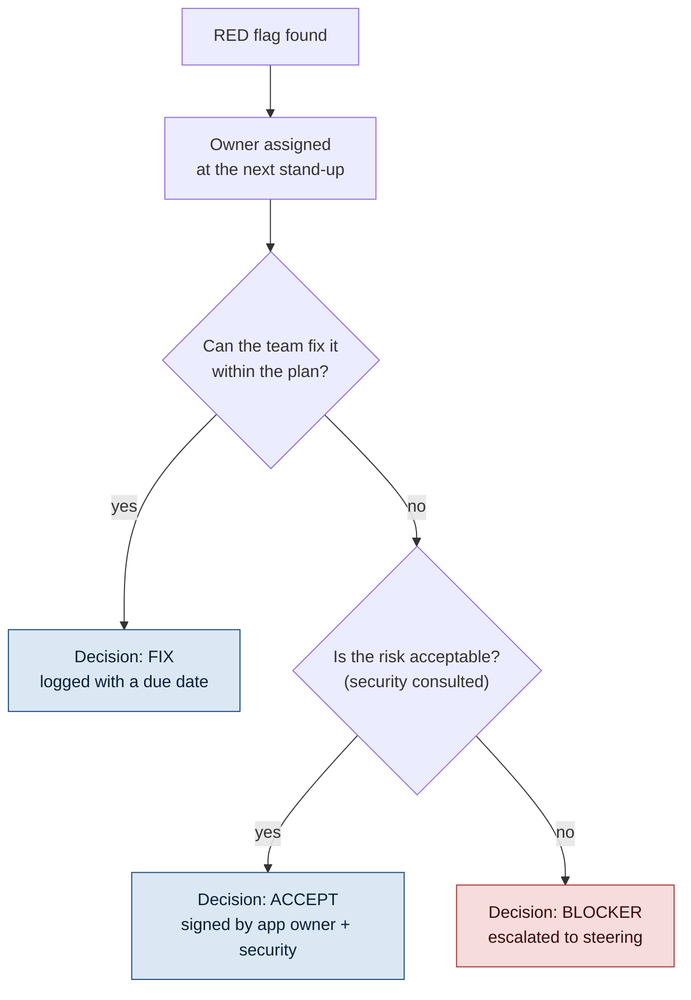
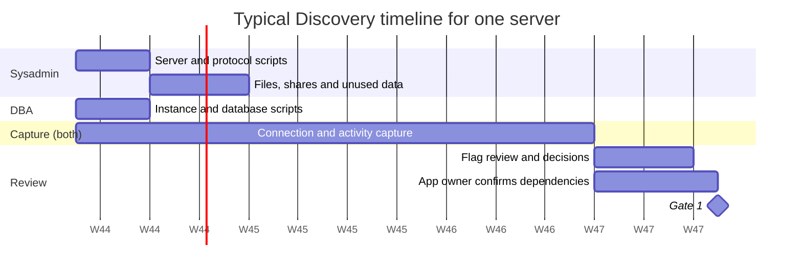
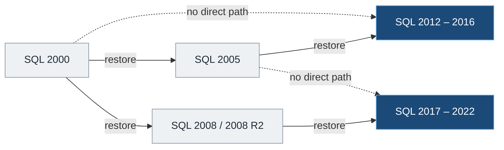
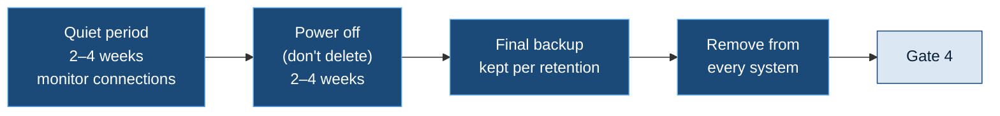

<p align="center">
  
</p>

<p align="center">
  <a href="#1-purpose-and-scope"><b>Scope</b></a> &nbsp;·&nbsp;
  <a href="#2-governance-model"><b>Governance</b></a> &nbsp;·&nbsp;
  <a href="#3-standards"><b>Standards</b></a> &nbsp;·&nbsp;
  <a href="#phase-1--discovery"><b>Discovery</b></a> &nbsp;·&nbsp;
  <a href="#phase-2--install--configure"><b>Install &amp; configure</b></a> &nbsp;·&nbsp;
  <a href="#phase-3--migration"><b>Migration</b></a> &nbsp;·&nbsp;
  <a href="#phase-4--decommissioning"><b>Decommissioning</b></a> &nbsp;·&nbsp;
  <a href="#appendix"><b>Appendix</b></a>
</p>

<p align="center"><sub>Living document · owner: Migration lead · review every quarter, or after every gate that found a gap in this guide</sub></p>

> [!IMPORTANT]
> **Three rules apply to everything below.**
> 1. **No gate, no next phase.** A phase is complete only when its gate checklist is signed.
> 2. **One accountable person per activity.** Many people can do the work; one person owns the result.
> 3. **Data that nobody reviewed doesn't count.** Every collected output has a reviewer's name and a date.

<p align="center"></p>

## 1. Purpose and scope

This guide sets out **who does what, what to collect, what to decide, and when a phase is done** when legacy Windows servers and SQL Server instances move to supported platforms. It replaces the narrative "loop document" with **checklists, owners and gates**.

| | In scope | Out of scope |
|---|---|---|
| **Platforms** | Windows Server 2003, 2003 R2, 2008, 2008 R2 | Desktop and endpoint migration |
| **Databases** | SQL Server 2000, 2005, 2008, 2008 R2 (instances, databases, jobs, packages) | Application code changes (tracked by the app team) |
| **Services** | File shares, FTP, IIS, scheduled jobs, print, legacy protocols | Network redesign and firewall policy (consulted, not owned) |
| **Data** | Live data, unused or stale data, backups, retention | Records-management policy (owned by the data owner) |

### Why this exists

| What happens today | What this guide changes |
|---|---|
| Everyone has their own discovery script | One approved script per role, versioned in Git |
| Output goes to SharePoint and nobody reads it | Each output has a **flag summary**, a reviewer and a date |
| Steps are explained in a long loop document | Checklists with owners and exit criteria |
| Nobody knows who decides | RACI tables and a decision log |
| Phases overlap and work gets done twice | Signed gates between phases |

<p align="center"></p>

## 2. Governance model

### 2.1 Lifecycle and gates

```mermaid
flowchart LR
    D["<b>1 · Discovery</b><br/>know the current state"] --> G1{{"Gate 1<br/>Migration lead"}}
    G1 --> I["<b>2 · Install & configure</b><br/>build the target"] --> G2{{"Gate 2<br/>Migration lead"}}
    G2 --> M["<b>3 · Migration</b><br/>rehearse, cut over, validate"] --> G3{{"Gate 3<br/>App owner"}}
    G3 --> X["<b>4 · Decommissioning</b><br/>quiet period, retire"] --> G4{{"Gate 4<br/>Migration lead"}}
    G1 -. "RED flag open" .-> D
    G3 -. "rollback" .-> M

    classDef phase fill:#1b4a78,stroke:#5fa8e8,color:#ffffff
    classDef gate fill:#dbe8f4,stroke:#1b4a78,color:#0b1f36
    class D,I,M,X phase
    class G1,G2,G3,G4 gate
```



| # | Phase | Ends when | Gate owner | Typical duration |
|:-:|---|---|---|---|
| **1** | Discovery | The current state is known and reviewed, and every red flag has a decision | Migration lead | 3–5 weeks (includes a 2–4 week capture) |
| **2** | Install & configure | The target is built to standard, hardened and smoke-tested | Migration lead | 1–2 weeks |
| **3** | Migration | A rehearsal is done, cut-over is complete, data is validated and the app owner has accepted | **App owner** | 1–3 weeks |
| **4** | Decommissioning | Quiet period with no connections, final backup taken, server removed everywhere | Migration lead | 4–8 weeks (mostly waiting) |

### 2.2 Roles

| Role | Owns | Typical person |
|---|---|---|
| **Sysadmin** | OS, server, files, network and security discovery; target server build; OS-level cut-over; decommissioning the server | Windows team |
| **DBA** | Instance and database discovery; SQL build; data migration and validation; decommissioning the instance | DBA team |
| **App owner** | Dependencies, users, business windows, testing, acceptance, decisions about unused data | Business or application team |
| **Migration lead** | Plan, tracking, decision log, gate sign-off (except Gate 3), escalation | Project or team lead |
| **Security / network** | Firewall rules, exceptions for legacy protocols, certificates, risk acceptance | Security and network teams |

### 2.3 RACI for all phases

<sub><b>R</b> does the work · <b>A</b> owns the result (exactly one per row) · <b>C</b> consulted · <b>I</b> informed</sub>

| Activity | Sysadmin | DBA | App owner | Migration lead | Sec / Net |
|---|:-:|:-:|:-:|:-:|:-:|
| ***Phase 1: Discovery*** | | | | | |
| Run the server discovery script | **R/A** | I | | I | |
| Run the SQL discovery script | C | **R/A** | | I | |
| Long-running connection capture | R | R | I | **A** | |
| Discover files, shares and unused data | **R** | | C | A | |
| Discover legacy protocols (SMBv1, FTP, TLS, NTLMv1) | **R** | C | I | A | C |
| Confirm the dependency list | R | R | **A** | C | |
| Review output and decide on flags | R | R | C | **A** | C |
| ***Phase 2: Install & configure*** | | | | | |
| Build and harden the target OS | **R/A** | I | | I | C |
| Install and configure SQL | C | **R/A** | | I | |
| Firewall rules, certificates, legacy-protocol exceptions | C | C | I | I | **R/A** |
| Smoke test of the target | R | R | C | **A** | |
| ***Phase 3: Migration*** | | | | | |
| Rehearsal migration | R | R | C | **A** | |
| Cut-over and rollback plan | R | R | C | **A** | C |
| Data migration and validation | C | **R/A** | C | I | |
| Application testing and acceptance | C | C | **R/A** | I | |
| ***Phase 4: Decommissioning*** | | | | | |
| Quiet-period monitoring | **R** | R | I | A | |
| Archiving or deleting unused data | R | R | **A** | C | |
| Server and instance removal from every system | **R** | R | I | **A** | C |

> [!NOTE]
> The Gate 3 sign-off belongs to the **app owner**, not IT. IT says the migration is technically complete; only the business can say it **works**.

### 2.4 Cadence

| Forum | When | Who | Output |
|---|---|---|---|
| **Migration stand-up** | Weekly, 30 min | Sysadmins, DBAs, migration lead | Status per server, new flags, blockers |
| **Gate review** | When a server is ready for a gate | Migration lead, the R people, app owner for Gate 3 | Signed gate, or a list of what's missing |
| **Steering** | Monthly | Migration lead, management, security | Risk acceptances, priorities, resources |

### 2.5 Decisions, exceptions and escalation

Every RED flag ends with **one recorded decision**: *fix*, *accept the risk*, or *blocker*. Decisions go in the **decision log** (template in the [Appendix](#appendix)), never only in email or chat.



> [!WARNING]
> A **risk acceptance** for a legacy protocol (SMBv1, FTP, TLS 1.0, NTLMv1) must have an **end date** and an owner. "Temporary" exceptions without an end date become permanent.

<p align="center"></p>

## 3. Standards

### 3.1 Scripts and repository

- Use the **approved scripts in the team's shared Git repository**. Never run a local or modified copy.
- Is the script missing something? **Change it in the repository** as a reviewed change, so everyone benefits. You don't need VS Code: the repository's web editor, or any text editor plus `git`, works.
- Every output records the **script version or commit** it came from.
- Discovery scripts are **read-only**. They never change or delete anything on the server.

### 3.2 Output naming and storage

```text
Migration/
└── <SERVER>/
    ├── 1-Discovery/
    │   ├── <SERVER>_SUMMARY_<yyyyMMdd>.csv          flags only, one row per finding
    │   ├── <SERVER>_<area>_<yyyyMMdd>.csv           e.g. APP01_services_20261022.csv
    │   └── <INSTANCE>_sql-<area>_<yyyyMMdd>.csv     e.g. APP01-SQL2005_sql-jobs_20261022.csv
    ├── 2-Build/
    ├── 3-Migration/
    ├── 4-Decommission/
    └── GATES.md                                     signed gate checklists for this server
```

All of this lives in **one SharePoint location**, with no copies in personal folders or mailboxes.

### 3.3 The flag summary

Raw data is for evidence; **the summary is what gets read**. Every script writes one summary file in this format:

| Server | Area | Item | Flag | Detail | Owner | Decision | Decided by | Date |
|---|---|---|---|---|---|---|---|---|
| APP01 | Protocols | SMBv1 server enabled | **RED** | 3 scanners connect over SMBv1 | Sysadmin | Fix: firmware update | J. Doe | 2026-10-30 |
| APP01 | SQL | Job owned by a person | AMBER | `Nightly export` owned by DOMAIN\jsmith | DBA | Fix: change to sa | A. Roy | 2026-10-30 |

<p align="center"></p>

<p align="center"></p>

## Phase 1 · Discovery

> **Goal:** know everything that **runs on**, **connects to**, or **depends on** the server **before** anything is built or moved.



### 1.1 Tooling limits on legacy servers

| Source OS | PowerShell | What this means |
|---|---|---|
| **2003 / 2003 R2** | None by default (2.0 only if WMF 2.0 / KB968930 was installed) | Run discovery **remotely** from a modern admin box over WMI/DCOM (`Get-WmiObject -ComputerName`), or locally with `wmic`, `netstat`, `reg query`, `net share` and `schtasks`. Don't install software just to discover the server. |
| **2008** | 1.0 (feature); 2.0 via WMF | Scripts must be **PowerShell 2.0 compatible**: no `Get-CimInstance`, no `ConvertTo-Json`, no `Get-SmbShare`. Use `Get-WmiObject` and `Export-Csv`. |
| **2008 R2** | 2.0 | Same as 2008. WinRM 2.0 may need its listener configured. The default execution policy is `Restricted`. |
| **2012 R2+** (targets) | 4.0+ | Full cmdlets: `Get-SmbServerConfiguration`, `Get-SmbOpenFile`, CIM. |

> [!TIP]
> **dbatools** needs a modern PowerShell. Run it from an **admin workstation** against the old instance, never on the legacy server. Most read commands still work against SQL 2000 and 2005.

### 1.2 Server: platform, identity and software

<table>
<tr><th width="33%">Platform</th><th width="33%">Identity and access</th><th width="33%">Software and roles</th></tr>
<tr valign="top"><td>

- [ ] OS, edition, SP, x86/x64, install language
- [ ] End-of-support date
- [ ] Physical or virtual, host, hardware age
- [ ] CPU, RAM, disks, growth, page file
- [ ] Activation and licensing (OEM, VL, KMS)

</td><td>

- [ ] Domain member? Domain controller?
- [ ] Local accounts and local Administrators
- [ ] Service accounts. **Is the password known and in the vault?**
- [ ] Credentials hard-coded in `.ini`, `.config`, `.udl`, `.bat` files and `net use` lines

</td><td>

- [ ] Installed software (including 16-bit installers, which don't run on x64)
- [ ] IIS, DHCP, DNS, print, MSMQ, COM+/DCOM, WINS
- [ ] Non-default services and their start mode
- [ ] Scheduled tasks and `AT` jobs (2003)
- [ ] ODBC DSNs, **32-bit and 64-bit**
- [ ] .NET, Java, VB6, Access runtimes
- [ ] Dongles, serial or USB devices, fax boards

</td></tr>
</table>

<details>
<summary><b>Commands that work on PowerShell 2.0 and on 2003</b></summary>

```powershell
# OS, including 2003 queried remotely from a modern box
Get-WmiObject Win32_OperatingSystem -ComputerName SRV01 |
  Select-Object CSName, Caption, CSDVersion, OSArchitecture, Version, OSLanguage, InstallDate

# Services that run as a named account (these need a known password on the target)
Get-WmiObject Win32_Service -ComputerName SRV01 |
  Where-Object { $_.StartName -notmatch 'LocalSystem|LocalService|NetworkService' } |
  Select-Object Name, DisplayName, StartName, StartMode, State |
  Export-Csv SRV01_services-accounts_20261022.csv -NoTypeInformation

# Installed software (both registry views)
'HKLM:\SOFTWARE\Microsoft\Windows\CurrentVersion\Uninstall\*',
'HKLM:\SOFTWARE\Wow6432Node\Microsoft\Windows\CurrentVersion\Uninstall\*' |
  ForEach-Object { Get-ItemProperty $_ -ErrorAction SilentlyContinue } |
  Where-Object { $_.DisplayName } |
  Select-Object DisplayName, DisplayVersion, Publisher, InstallDate |
  Export-Csv SRV01_software_20261022.csv -NoTypeInformation
```

```bat
:: Scheduled tasks with run-as account and command line (2003 and later)
schtasks /query /v /fo csv > SRV01_tasks_20261022.csv
:: 2003 only: legacy AT jobs
at
```

</details>

### 1.3 Server: network and dependencies

- [ ] IPs, subnet, gateway, DNS, WINS, extra NICs and IPs, NIC teaming
- [ ] DNS records and **aliases (CNAMEs)** that point at this server
- [ ] `hosts` and `lmhosts` entries
- [ ] Listening ports mapped to processes (`netstat -ano` + `tasklist /svc`)
- [ ] **Inbound and outbound connections over time.** A single `netstat` misses monthly and quarterly jobs. Capture every 5–15 minutes for **2–4 weeks**, including a month-end.
- [ ] Firewall rules here and upstream, plus **IP allow-lists on other systems** that name this server
- [ ] Hard-coded IPs and UNC paths in app configs
- [ ] Certificates: subject, SAN, expiry, issuer, **exportable private key?** SHA-1 or 1024-bit keys won't be accepted on modern targets.
- [ ] Backup agent and last good backup; monitoring and AV agents, AV exclusions

### 1.4 Server: legacy protocols and insecure settings

These are the items most likely to **break during or after migration**, because modern Windows disables them or doesn't install them.

| Item | How to check on 2003 / 2008 | Why it matters |
|---|---|---|
| **SMBv1 server** | 2003 only speaks SMBv1. On 2008 / 2008 R2: registry `HKLM\SYSTEM\CurrentControlSet\Services\LanmanServer\Parameters` → `SMB1` (missing = enabled) | Server 2019+ doesn't install SMBv1. Plan as if it can't be used. |
| **SMBv1 clients** | 2003 and 2008 have no SMBv1 audit. Record `net session` and `net file` over time, then identify each client: XP, 2003, **scanners and MFPs, NAS, embedded devices, old Samba** | These clients can't reach a modern file server. Each needs an upgrade, firmware, or a decision. |
| **SMBv1 as a client** | `HKLM\SYSTEM\CurrentControlSet\Services\mrxsmb10` → `Start` | The app may pull files from an old NAS or device that only speaks SMBv1. |
| **FTP server** | IIS 6 FTP (`MSFTPSVC`), IIS 7.5 FTP (`FTPSVC`), FileZilla, Serv-U, WS_FTP. Check services, listeners on 21 or other ports, site config, logs in `%windir%\system32\LogFiles\MSFTPSVC*` | Clear-text passwords, anonymous access, partners or devices that drop files. Find **who** connects (from the logs) and **what** processes the files. |
| **FTP clients** | Scheduled tasks and scripts that call `ftp.exe -s:<file>`, WinSCP or `curl`. Read the `-s:` file for the host and **credentials** | Hidden outbound dependencies with stored passwords |
| **TLS / SSL** | `HKLM\SYSTEM\CurrentControlSet\Control\SecurityProviders\SCHANNEL\Protocols`. 2003 can't do TLS 1.1 or 1.2; 2008 R2 only does them if enabled | Partners and clients that only speak SSL3 or TLS 1.0 will fail. |
| **NTLMv1 / LM** | `HKLM\SYSTEM\CurrentControlSet\Control\Lsa` → `LmCompatibilityLevel`, `NoLMHash` | Old apps and devices fail against hardened targets. |
| **Telnet, rsh, SNMP v1/v2** | Services, listeners, SNMP community strings | Replace (SSH, SNMPv3), or accept the risk with an end date. |
| **Other legacy items** | WINS, NetBIOS name use, 8.3 short names, `subst` drives, mapped drives in a service context | These usually appear only after cut-over. |

<details>
<summary><b>Commands: SMBv1, FTP, sessions</b></summary>

```powershell
# SMBv1 server on 2008/2008 R2 (no value = enabled)
Get-ItemProperty 'HKLM:\SYSTEM\CurrentControlSet\Services\LanmanServer\Parameters' |
  Select-Object SMB1, SMB2

# SMBv1 client driver (4 = disabled)
(Get-ItemProperty 'HKLM:\SYSTEM\CurrentControlSet\Services\mrxsmb10').Start

# FTP services present?
Get-Service MSFTPSVC, FTPSVC, 'FileZilla Server' -ErrorAction SilentlyContinue

# Scripts that drive ftp.exe with a command file (often holding a password)
Get-ChildItem C:\, D:\ -Recurse -Include *.bat, *.cmd, *.vbs, *.ps1 -ErrorAction SilentlyContinue |
  Select-String -Pattern 'ftp(\.exe)?\s.*-s:' |
  Select-Object Path, LineNumber, Line
```

```bat
:: Who is connected to shares right now (schedule this during the capture period)
net session >> SRV01_sessions_capture.txt
net file    >> SRV01_openfiles_capture.txt
```

</details>

### 1.5 Server: files, shares and unused data

> [!IMPORTANT]
> Discovery only **reports**. The **app owner or data owner decides** what to archive or delete. That happens in Phase 4, never during Discovery.

- [ ] Every share: path, share and NTFS permissions, size, file count
- [ ] Data grouped by **last-modified age**: < 1 year · 1–3 years · 3–7 years · > 7 years
- [ ] Home or user folders of **disabled or deleted AD accounts**
- [ ] File types that carry risk or hide dependencies:

  | Type | Why |
  |---|---|
  | `.mdb` `.accdb` | Access databases, often with **linked tables pointing to SQL** or ODBC DSNs |
  | `.xls*` | External data connections to SQL or ODBC |
  | `.pst` `.ost` | Mail archives; owner and retention questions |
  | `.bak` `.trn` `.mdf` `.ldf` | Stray SQL files outside the instance |
  | `.bat` `.cmd` `.vbs` `.ps1` | Scripts with paths, servers and credentials |
  | `.iso` `.vhd` installers | Large files, rarely needed |

- [ ] Duplicate and very large files
- [ ] Open files and sessions during the capture, to see which shares are **actually used**
- [ ] Data on local drives that isn't in any share (app data, exports, logs)
- [ ] Retention or legal holds. Ask the data owner; **old doesn't automatically mean deletable**.

> [!CAUTION]
> Don't use **LastAccessTime**. On 2008+ it isn't updated by default (`fsutil behavior query disablelastaccess`). On 2003 it is, but antivirus and backup scans touch it too. Use **LastWriteTime**, together with the session and open-file capture.

<details>
<summary><b>Command: data by age, PowerShell 2.0 compatible</b></summary>

```powershell
$root = 'D:\Shares'
$now  = Get-Date
Get-ChildItem $root -Recurse -ErrorAction SilentlyContinue |
  Where-Object { -not $_.PSIsContainer } |
  ForEach-Object {
    $age = ($now - $_.LastWriteTime).Days / 365
    $bucket = if ($age -lt 1) {'<1y'} elseif ($age -lt 3) {'1-3y'} elseif ($age -lt 7) {'3-7y'} else {'>7y'}
    New-Object PSObject -Property @{ Bucket = $bucket; Bytes = $_.Length; Ext = $_.Extension.ToLower() }
  } |
  Group-Object Bucket |
  Select-Object Name, Count, @{n='GB'; e={ [math]::Round(($_.Group | Measure-Object Bytes -Sum).Sum / 1GB, 2) }} |
  Export-Csv SRV01_file-age_20261022.csv -NoTypeInformation
```

</details>

### 1.6 SQL: instance

<table>
<tr><th width="33%">Version and support</th><th width="33%">Security</th><th width="33%">Features in use</th></tr>
<tr valign="top"><td>

- [ ] Version, edition, SP/CU, x86/x64
- [ ] Instance name, port (static or dynamic), Browser
- [ ] Server collation, and databases with a different collation
- [ ] Service accounts, SPNs, delegation
- [ ] Memory, MAXDOP, non-default `sp_configure` settings, trace flags
- [ ] Startup parameters and tempdb layout

</td><td>

- [ ] Logins (SQL and Windows), server roles, `sa` state
- [ ] SQL logins with weak or blank passwords (SQL 2000 has **no password policy**)
- [ ] Orphaned users per database
- [ ] TDE, certificates, master keys, credentials, proxies. **Are the keys backed up?**
- [ ] Forced encryption and its certificate

</td><td>

- [ ] Agent jobs: owner, schedule, steps, **what they touch outside SQL**
- [ ] Operators, alerts, Database Mail, **SQL Mail** (removed after 2008 R2)
- [ ] Maintenance plans (2000/2005 plans **don't migrate**)
- [ ] **DTS packages** (2000). Not supported on 2012+, so they need a rewrite to SSIS
- [ ] SSIS, SSRS reports and subscriptions, SSAS
- [ ] Linked servers, OPENROWSET / OPENQUERY
- [ ] Replication, log shipping, mirroring, clustering
- [ ] CLR, extended procedures, `xp_cmdshell`
- [ ] Cross-database and cross-server names

</td></tr>
</table>

**Which restore paths work.** Plan the number of hops **now**:



<sub>SQL 2000 backups need an intermediate hop (2005 / 2008 / 2008 R2) to reach 2012+. SQL 2005 restores up to 2016 but not on 2017+. Check the minimum source version of your exact target and run Data Migration Assistant from a modern box.</sub>

### 1.7 SQL: databases

- [ ] Name, size (data and log), growth, file locations, owner
- [ ] Compatibility level, recovery model
- [ ] Page verify: SQL 2000 databases are often `TORN_PAGE_DETECTION` or `NONE`. Plan `CHECKSUM` after migration.
- [ ] Last good `DBCC CHECKDB`. Run one **before** migration so you know whether corruption was already there.
- [ ] Backups: target, frequency, last good one, and the **RPO/RTO agreed with the app owner**
- [ ] **Is it used?** See 1.8
- [ ] Applications and connection strings that use it, **from the capture, not from memory**

### 1.8 SQL: activity and auditing on old versions

Old versions can't tell you who uses a database the way modern ones can. **SQL Server Audit doesn't exist before 2008**, and on 2008 / 2008 R2 it's **Enterprise-only**. Use what each version offers, and **capture for 2–4 weeks**.

| Version | Who connects | Is the database used | Who changes what |
|---|---|---|---|
| **SQL 2000** | Snapshot `master..sysprocesses` every 5–15 min | No usage DMVs. Use a light **server-side trace** (login, batch completed, filtered) | Server-side trace. **C2 audit mode** only as a last resort: it's heavy and stops the instance if the disk fills |
| **SQL 2005** | Snapshot `sys.dm_exec_sessions` + `sys.dm_exec_connections` (client IP) | `sys.dm_db_index_usage_stats`. **It resets on restart**: check uptime via tempdb `create_date` | **Default trace** (rolls over fast: 5 × 20 MB), DDL triggers, logon triggers (SP2+) |
| **SQL 2008 / R2** | Same as 2005 | Same, plus `sys.dm_os_sys_info.sqlserver_start_time` | **SQL Server Audit** on Enterprise; otherwise the 2005 methods |

<details>
<summary><b>T-SQL: connection snapshots and usage, per version</b></summary>

```sql
-- SQL 2000: who is connected (schedule every 5–15 min, insert into a capture table)
SELECT GETDATE() AS captured_at, spid,
       RTRIM(hostname) AS host, RTRIM(program_name) AS program,
       RTRIM(loginame) AS login, DB_NAME(dbid) AS db
FROM master..sysprocesses
WHERE spid > 50;
```

```sql
-- SQL 2005 / 2008: who is connected, with client IP
SELECT GETDATE() AS captured_at, c.client_net_address,
       s.host_name, s.program_name, s.login_name, DB_NAME(p.dbid) AS db
FROM sys.dm_exec_sessions    AS s
JOIN sys.dm_exec_connections AS c ON c.session_id = s.session_id
JOIN sys.sysprocesses        AS p ON p.spid = s.session_id
WHERE s.is_user_process = 1;
```

```sql
-- SQL 2005 / 2008: last read and write per database since the service started
SELECT create_date AS sql_started FROM sys.databases WHERE name = 'tempdb';

SELECT DB_NAME(database_id) AS db,
       MAX(last_user_seek)   AS last_seek,
       MAX(last_user_scan)   AS last_scan,
       MAX(last_user_lookup) AS last_lookup,
       MAX(last_user_update) AS last_update
FROM sys.dm_db_index_usage_stats
GROUP BY database_id;
```

```sql
-- All versions: jobs owned by a person, orphaned users
SELECT j.name, SUSER_SNAME(j.owner_sid) AS owner FROM msdb.dbo.sysjobs AS j;
EXEC sp_change_users_login 'Report';   -- run in each user database
```

</details>

- [ ] Turn on **login auditing** ("both failed and successful logins") for the capture period. It writes to the errorlog, so check the errorlog size and recycle schedule.
- [ ] A database with **no reads or writes during the whole capture** is a **candidate** for archiving. The app owner decides.
- [ ] Hand the compiled *host · app · login · database* list to the app owner to **confirm**.

### 1.9 Red and amber flags

<table>
<tr><th width="50%">RED: blocks migration until decided</th><th width="50%">AMBER: needs a plan</th></tr>
<tr valign="top"><td>

- Unsupported source → target path (e.g. SQL 2000 → 2019 direct)
- DTS packages, 16-bit apps, hardware dongles
- SMBv1 client that can't be upgraded
- FTP, or clear-text credentials in scripts
- TDE or encryption keys not backed up
- No backup, or last good backup older than 7 days
- Unknown inbound connections after the capture

</td><td>

- Certificate expiring within 90 days
- Job or database owned by a personal account
- Data older than 7 years with no owner
- Service account password unknown
- No `CHECKSUM` page verify, no recent CHECKDB
- Dynamic SQL port, hard-coded IPs
- Database with no activity during the capture

</td></tr>
</table>

### Gate 1 · Discovery complete

- [ ] Server and SQL scripts ran from the **approved repository version** (version recorded in the summary)
- [ ] Capture covered at least **2 weeks**, including a month-end if possible
- [ ] Output is in `Migration/<SERVER>/1-Discovery/` with standard names
- [ ] Summary **reviewed by** the sysadmin ______ and the DBA ______ on ______
- [ ] Every RED flag has an owner and a logged decision
- [ ] App owner has **confirmed the dependencies** and the unused-data candidates
- [ ] Target platform and path chosen (OS and SQL versions, number of hops, in-place or side-by-side)
- [ ] **Migration lead sign-off:** ______ on ______

<p align="center"></p>

<p align="center"></p>

## Phase 2 · Install & configure

> **Goal:** a target that is **built to standard, hardened, and ready**, with every prerequisite that Discovery found already in place.

<table>
<tr><th width="50%">Sysadmin: server</th><th width="50%">DBA: SQL</th></tr>
<tr valign="top"><td>

- [ ] Built from the **standard image or build**, on a supported OS
- [ ] Patched, and joined to the correct OU (GPOs applied)
- [ ] Disk layout to standard (OS · apps · data · logs · tempdb · backups)
- [ ] Service accounts created, or **gMSAs** where the app supports them; passwords in the vault
- [ ] Roles and features from Discovery installed (IIS, .NET 3.5, MSMQ, …)
- [ ] **SMBv1 off**, TLS 1.2+ only, NTLMv1 refused, unless an exception is signed
- [ ] FTP replaced by **SFTP/FTPS** where possible, or an exception signed
- [ ] Certificates issued (SHA-256, 2048-bit+), private keys exportable per policy
- [ ] Backup, monitoring, AV (with exclusions) and logging agents installed
- [ ] Scheduled tasks prepared but **disabled**

</td><td>

- [ ] Supported version and edition, latest CU
- [ ] Collation **matches** the source (or a documented change)
- [ ] Service accounts, SPNs, static port, firewall rule
- [ ] Memory, MAXDOP, cost threshold, tempdb files to standard
- [ ] Backups, integrity checks and index maintenance jobs (standard solution, not legacy maintenance plans)
- [ ] Database Mail, operators and alerts configured
- [ ] Logins scripted from the source (SIDs and hashes kept) but **not yet enabled** for apps
- [ ] SSIS / SSRS installed if Discovery found them; DTS rewrite tracked
- [ ] Linked servers recreated with **non-personal** credentials
- [ ] Auditing enabled (SQL Server Audit is available on all editions from 2012 at server level)

</td></tr>
</table>

### Gate 2 · Target ready

- [ ] Build checklist complete, with deviations recorded in the decision log
- [ ] Security / network: firewall rules, certificates and exceptions **done and signed**
- [ ] Backup of the empty target tested (restore proven)
- [ ] Monitoring is green
- [ ] Smoke test passed (app installs and starts, connects to an empty or test database)
- [ ] **Migration lead sign-off:** ______ on ______

<p align="center"></p>

<p align="center"></p>

## Phase 3 · Migration

> **Goal:** data, apps and dependencies move **once**, in a rehearsed and timed window, with a rollback that has been tested.

### 3.1 Choose the method

| Method | When to use | Watch out for |
|---|---|---|
| **Side-by-side** (new server, move app and data) | **Default** for 2003 / 2008 | DNS and aliases, IP allow-lists, hard-coded names |
| **In-place OS upgrade** | Only when side-by-side isn't possible; limited paths (2008 R2 → 2012 R2 → newer) | Each hop needs its own licence and a snapshot; no path at all from 2003 |
| **Backup / restore** (SQL) | Most databases; downtime equals the restore time | Restore-version hops (see 1.6); orphaned users |
| **Log shipping or differential catch-up** (SQL) | Large databases with a short window | The target must be able to restore the source version |
| **Detach / attach** | Rarely; when backup and restore is too slow | No rollback once upgraded; keep a copy |
| **Robocopy** (files) | File shares | `/COPYALL`, a preliminary pass plus a final delta, long paths |

### 3.2 Runbook


- [ ] **Rehearsal** on a copy, timed. The real window = rehearsal time + 50%.
- [ ] **Rollback plan** with a clear **point of no return** and who calls it
- [ ] Users and app owner notified; change ticket approved
- [ ] Source set to **read-only** (or services stopped) before the final copy, so no writes are lost
- [ ] Logins fixed (orphaned users), jobs enabled, linked servers tested
- [ ] Compatibility level raised **after** validation, not during cut-over
- [ ] `CHECKSUM` page verify set; `DBCC CHECKDB` on the target
- [ ] Row counts and checksums compared for key tables
- [ ] DNS and aliases switched; old name kept as a CNAME **if** the app needs it
- [ ] Every dependency from Discovery tested: scanners, FTP partners, reports, interfaces

### Gate 3 · Accepted

- [ ] Validation evidence stored in `3-Migration/`
- [ ] All Discovery dependencies tested and marked OK
- [ ] First backup on the target, and a **restore tested**
- [ ] Monitoring green for 48 h
- [ ] **App owner acceptance:** ______ on ______

<p align="center"></p>

<p align="center"></p>

## Phase 4 · Decommissioning

> **Goal:** the old server is retired **cleanly and reversibly** until the wait period ends, and leaves nothing behind in any system.



- [ ] **Quiet period:** keep the connection capture running on the **old** server. Any hit is a missed dependency, so fix it before you continue.
- [ ] Unused-data decisions from Discovery carried out: archive, move or delete, **signed by the data owner**
- [ ] SQL: databases set offline first, then a final backup; logins disabled
- [ ] Server **powered off, not deleted**, for the agreed wait
- [ ] Final full backup (server + databases) kept per retention policy, with a **restore test**

**Removal checklist:**

<table>
<tr><td>

- [ ] Active Directory computer object
- [ ] DNS A, PTR and CNAME records
- [ ] DHCP reservations
- [ ] Firewall rules and allow-lists

</td><td>

- [ ] Monitoring
- [ ] Backup jobs
- [ ] Antivirus / EDR console
- [ ] Patch management (WSUS, SCCM)

</td><td>

- [ ] CMDB / inventory
- [ ] Licences reclaimed (OS, SQL, CALs)
- [ ] Service accounts disabled, then deleted
- [ ] Certificates revoked

</td></tr>
</table>

### Gate 4 · Retired

- [ ] No connections seen during the quiet period
- [ ] Final backup kept, with the restore test recorded
- [ ] Removal checklist complete
- [ ] VM or hardware deleted or disposed of per policy (disks wiped)
- [ ] **Migration lead sign-off:** ______ on ______

<p align="center"></p>

## Appendix

### A. Decision log template

| ID | Date | Server | Flag / topic | Decision (fix · accept · blocker) | Rationale | Owner | End date (for an accept) | Signed by |
|---|---|---|---|---|---|---|---|---|
| D-001 | | | | | | | | |

### B. Gate sign-off template (`GATES.md` per server)

```text
SERVER: APP01            PHASE: 1 - Discovery          GATE OWNER: <name>

[x] Scripts from approved version .......... v1.4 (commit 3f2a91c)
[x] Capture period ......................... 2026-11-02 -> 2026-11-23
[x] Summary reviewed ....................... sysadmin <name> / DBA <name> - 2026-11-25
[x] RED flags decided ...................... D-014, D-015, D-016
[x] Dependencies confirmed by app owner .... <name> - 2026-11-26

SIGNED: <name>                               DATE: 2026-11-27
```

### C. Glossary

| Term | Meaning |
|---|---|
| **Gate** | A signed checkpoint between two phases |
| **RACI** | Responsible, Accountable, Consulted, Informed |
| **Capture** | Recording connections or activity at regular intervals over weeks, not a single snapshot |
| **Flag** | A finding that needs a decision (RED) or a plan (AMBER) |
| **Quiet period** | Time after cut-over when the old server stays up and is watched for missed dependencies |
| **Hop** | An intermediate version needed because the source can't go straight to the target |

<p align="center"></p>

<p align="center"><sub>Migration governance · maintained by the Migration lead · change this guide through a reviewed change in the repository, like the scripts</sub></p>
