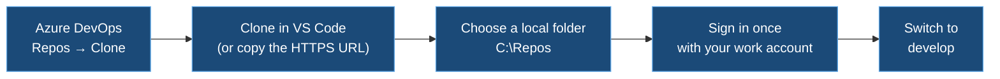
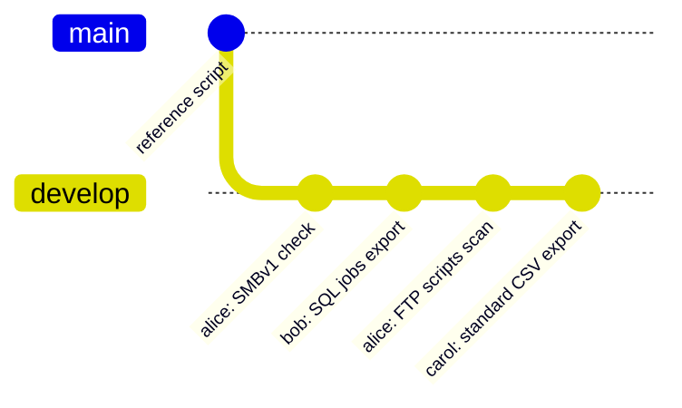
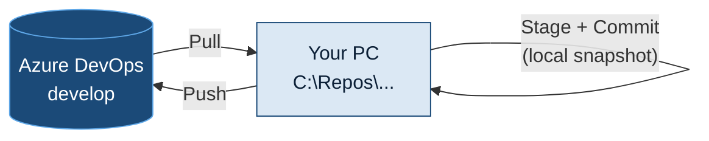
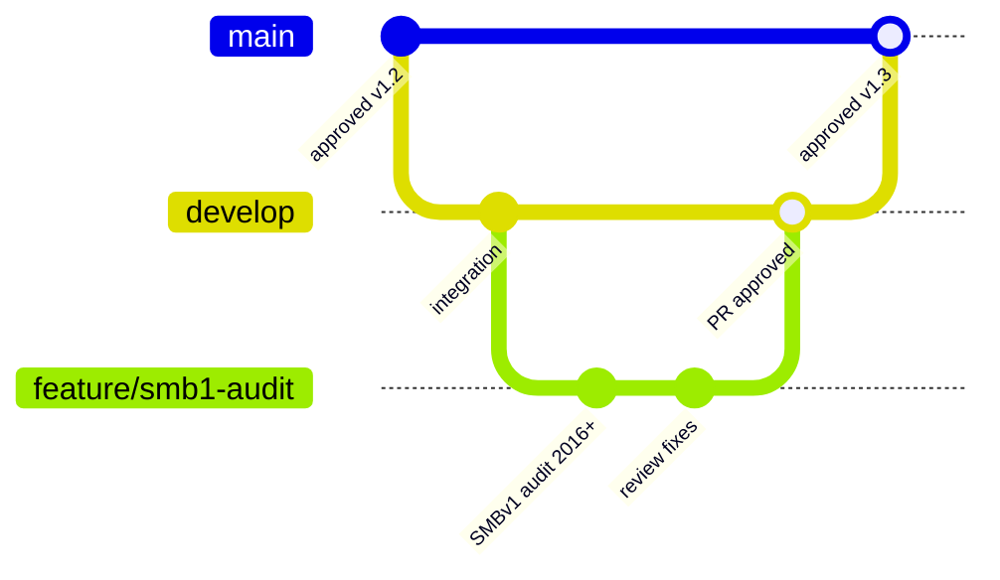

<p align="center">
  
</p>

<p align="center">
  <a href="#1-bring-your-own-script"><b>Bring your own script</b></a> &nbsp;·&nbsp;
  <a href="#2-repository-layout"><b>Repository</b></a> &nbsp;·&nbsp;
  <a href="#3-set-up-vs-code"><b>VS Code setup</b></a> &nbsp;·&nbsp;
  <a href="#32-connect-to-azure-devops-and-get-the-repository"><b>Azure DevOps</b></a> &nbsp;·&nbsp;
  <a href="#42-your-first-commit-and-push-step-by-step"><b>First commit</b></a> &nbsp;·&nbsp;
  <a href="#4-daily-workflow-on-develop"><b>Daily workflow</b></a> &nbsp;·&nbsp;
  <a href="#5-copilot"><b>Copilot</b></a> &nbsp;·&nbsp;
  <a href="#6-checklist-before-you-push"><b>Checklist</b></a> &nbsp;·&nbsp;
  <a href="README.md"><b>Governance guide</b></a>
</p>

<p align="center"><sub>Companion to the <a href="README.md">migration governance guide</a> · for sysadmins and DBAs who write or run discovery and migration scripts</sub></p>

> [!IMPORTANT]
> **Use the script you know. Share it in the team repository.**
> Your own script is welcome, as long as it follows the five rules in [section 1](#1-bring-your-own-script) and is pushed to the repository before it runs on a production server.

<p align="center"></p>

## 1. Bring your own script

Many of us already have discovery scripts that work. There's no need to rewrite them. What the migration needs is **comparable output**, **safe execution** and a record of **what ran where**.

### The five rules

| # | Rule | Why |
|:-:|---|---|
| **1** | **Standard output.** Produce the standard file names, CSV columns and flag summary ([governance guide §3.2–3.3](README.md#32-output-naming-and-storage)) | Results can be compared across servers and bundles, and the summary is what gets reviewed |
| **2** | **Checklist coverage.** Collect the Discovery checklist items for your role, whatever the tool | Nothing is missed (SMBv1, FTP, monthly jobs, …) |
| **3** | **Read-only.** Discovery scripts never change anything on the server | Safety on production |
| **4** | **No secrets.** No passwords in scripts, config files or output. Credentials come from the vault or `Get-Credential` at run time | Security requirement |
| **5** | **In the repository first.** The version that runs on production is in the repository, and its version or commit is recorded in the summary | Answers "what ran on this server, with admin rights?" |

How a script is written (style, structure, language, tool) is **up to its author**.

> [!TIP]
> **Already have a script?** Usually it only needs an **export step at the end** that writes the standard CSV names and the flag summary. That's often a short job, and Copilot can help ([section 5](#5-copilot)).
>
> **Don't have one?** Use the **reference script** in `discovery/reference/`. It's optional; it covers 2003 to 2019, and runs on PowerShell 2.0 with the newer cmdlets used only where they exist.

### Script header

Every script starts with a short comment-based help block, so anyone can see what it does, what it needs and who to ask:

```powershell
<#
.SYNOPSIS
    Server discovery: services, tasks, shares, SMBv1, FTP.
.DESCRIPTION
    Read-only. Writes <SERVER>_<area>_<yyyyMMdd>.csv and <SERVER>_SUMMARY_<yyyyMMdd>.csv
    to the output folder given in -OutputPath.
.PARAMETER ComputerName
    Server to discover. Defaults to the local computer.
.PARAMETER OutputPath
    Folder for the CSV files.
.NOTES
    Author   : <name>
    Version  : 1.3.0
    Requires : PowerShell 2.0+ (runs on 2008 R2); remote WMI for 2003
    Changes  : 1.3.0 - added SMBv1 client check
.EXAMPLE
    .\Get-ServerDiscovery.ps1 -ComputerName APP01 -OutputPath D:\Discovery
#>
```

<p align="center"></p>

## 2. Repository layout

One repository for the whole team. Each author keeps their own folder, so nobody's work is overwritten and credit stays visible.

```text
migration-scripts/
├── README.md                         what's here, link to this guide
├── COPILOT-CONTEXT.md                team context to paste into Microsoft 365 Copilot (see 5.2)
├── .github/
│   └── copilot-instructions.md       team rules for GitHub Copilot, when licensed (see 5.6)
├── .gitignore                        keeps output and secrets out of Git
├── discovery/
│   ├── reference/                    optional reference script (2003–2019)
│   ├── <author>/                     each person's own scripts
│   │   ├── Get-ServerDiscovery.ps1
│   │   └── README.md                 one paragraph: what it covers, how to run it
│   └── sql/
│       └── <author>/                 DBA scripts (T-SQL, dbatools)
├── common/
│   └── Export-StandardOutput.ps1     shared export step for the standard CSVs
└── checks/
    └── Test-DiscoveryOutput.ps1      checks a SharePoint folder for missing files or columns
```

**`.gitignore`**: discovery output and credentials never go to Git.

```gitignore
# Discovery output belongs in SharePoint, not Git
*.csv
*.xlsx
output/
# Credentials and local settings
*.cred
*.secret
.env
.vscode/settings.json
```

<p align="center"></p>

## 3. Set up VS Code

You install it once, and it takes about 15 minutes. VS Code runs on your **admin workstation**, not on the legacy servers.

### 3.1 Install

1. Install **Visual Studio Code** and **Git for Windows** from the company software portal.
2. Open VS Code, go to **Extensions** (`Ctrl+Shift+X`) and install:

| Extension | What it does |
|---|---|
| **PowerShell** (Microsoft) | Syntax, IntelliSense, debugging, and **PSScriptAnalyzer** warnings as you type |
| **GitHub Copilot** (later) | Only once GitHub Copilot Business is licensed ([5.6](#56-target-github-copilot-business)). Microsoft 365 Copilot doesn't need an extension |
| **SQL Server (mssql)** (Microsoft) | For DBAs: run T-SQL against an instance from VS Code |
| **GitLens** (optional) | Shows who changed each line and when |

3. Tell Git who you are, once. In the terminal (`` Ctrl+` ``):

```powershell
git config --global user.name  "First Last"
git config --global user.email "first.last@company.com"
```

### 3.2 Connect to Azure DevOps and get the repository

You don't need an extension, a password or a token. **Git for Windows** includes the **Git Credential Manager**, which signs you in to Azure DevOps with your **work account**, the same one as Outlook and Teams.



**Step by step**

1. In the browser, open **Azure DevOps** → your project → **Repos** → **Files**, and select the scripts repository at the top.
2. Click **Clone** (top right). Then either:
   - click **Clone in VS Code**, and allow the browser to open VS Code; or
   - copy the **HTTPS** URL. In VS Code, press `Ctrl+Shift+P`, type **Git: Clone**, and paste the URL.
3. Choose a local folder, for example **`C:\Repos`**.
4. A Microsoft sign-in window appears the first time. Sign in with your **work account**. Git remembers it, and you won't be asked again.
5. When VS Code asks *"Would you like to open the cloned repository?"*, click **Open**.
6. Switch to the team branch: click the **branch name** in the bottom-left corner of VS Code (it probably shows `main`), then choose **`origin/develop`**. The status bar now shows **`develop`**.

> [!CAUTION]
> **Don't clone into OneDrive** (Desktop or Documents are often synced). OneDrive and Git both manage the same files and cause conflicts. Use a plain local folder such as `C:\Repos`.

> [!NOTE]
> Use **HTTPS**, not SSH, and don't use **Generate Git Credentials** in Azure DevOps unless the tech lead asks you to. The Credential Manager sign-in is enough.

### 3.3 Where things are

| Shortcut | Opens |
|---|---|
| `Ctrl+Shift+E` | Explorer (files) |
| `Ctrl+Shift+G` | **Source Control**: changes, commit, push |
| `` Ctrl+` `` | Terminal (PowerShell) |
| `Ctrl+Shift+P` | Command palette (every command) |
| `F5` / `F8` | Run the script / run the selected lines |

> [!NOTE]
> **PowerShell 2.0 targets.** VS Code runs your script with the workstation's PowerShell 5.1 or 7. That's fine for editing and syntax checks, but **test on a real 2008 / 2008 R2 server, or a lab copy**, before running it in a bundle. A cmdlet that works on your workstation may not exist there.

<p align="center"></p>

## 4. Daily workflow on `develop`

For now, the team works on **one branch: `develop`**. Everyone pulls from it and pushes to it. That keeps things simple, as long as everyone **pulls before starting** and **pushes small changes often**.



### 4.1 Words you'll see

| Word | Meaning |
|---|---|
| **Repository (repo)** | The shared folder of scripts, with its full history, stored in Azure DevOps |
| **Clone** | Your local copy of the repo, made once (3.2) |
| **Branch** | A line of work. The team uses **`develop`** |
| **Pull** | Bring your colleagues' latest changes **from** Azure DevOps to your PC |
| **Stage** | Choose which changed files go into the next commit |
| **Commit** | Save a snapshot of your staged changes **on your PC**, with a message. Nobody else sees it yet |
| **Push** | Send your commits **to** Azure DevOps, so the team gets them |
| **Sync** | VS Code's button that does a pull and then a push |
| **origin** | Git's name for the Azure DevOps copy of the repo |



### 4.2 Your first commit and push, step by step

An example: adding your existing discovery script to the repo.

**1. Get the latest version.** Open **Source Control** (`Ctrl+Shift+G`), click **`...`** at the top, then **Pull**. You can also click the circular arrows next to `develop` in the status bar.

**2. Add your script.** In **Explorer** (`Ctrl+Shift+E`), right-click `discovery` → **New Folder** → your name (for example `jdoe`). Drag your `.ps1` file from Windows Explorer into that folder, or create it with **New File**. Add a short `README.md` next to it.

**3. See what changed.** Back in **Source Control**, your files are listed under **Changes**, each with a letter:

| Letter | Meaning |
|:-:|---|
| **U** | Untracked: a new file Git hasn't seen before |
| **M** | Modified |
| **D** | Deleted |

Click a file to see a **side-by-side comparison**: the old version on the left, yours on the right.

**4. Stage.** Hover over a file and click **`+`** (*Stage Changes*). It moves to **Staged Changes**. To stage everything, click the `+` on the **Changes** heading.

**5. Commit.** Type a message in the box at the top, for example `discovery: add jdoe server discovery script`. Then click **Commit** (or press `Ctrl+Enter`). The commit is saved **on your PC only**.

**6. Push.** The button now says **Sync Changes ↑1**, meaning one commit is waiting to go up. Click it. The first time, VS Code explains that it will pull and push: click **OK**.

**7. Check in Azure DevOps.** In the browser, go to **Repos** → **Commits**, choose the **`develop`** branch, and your commit is at the top. Under **Repos** → **Files**, your folder and script are visible to the whole team.

> [!TIP]
> If you click **Commit** with nothing staged, VS Code offers to **stage all changes and commit them directly**. That's fine when you've checked every file in the list.

### 4.3 The daily loop

| Step | In VS Code | Equivalent command |
|---|---|---|
| **1. Pull** before you start | Source Control → `...` → **Pull**, or the arrows next to `develop` in the status bar | `git pull` |
| **2. Write and test** | Edit; run with `F5` against a test server | |
| **3. Review** your changes | Source Control: click each file to see the side-by-side comparison | `git diff` |
| **4. Stage and commit** | `+` on the files, type a message, **Commit** (`Ctrl+Enter`) | `git add <file>` then `git commit -m "..."` |
| **5. Push** | **Sync Changes** (pull, then push) | `git pull` then `git push` |

Push at least **once a day** when you've changed something. Commits that stay on your PC aren't backed up, and nobody else can see them.

### 4.4 Commit messages

Short, in the form `<area>: what changed`, so the history reads like a changelog:

```text
discovery: add SMBv1 client check for 2012+
sql: export Agent jobs with monthly schedules
common: summary file now includes the script version
fix: Get-ServerDiscovery failed on 2003 without PowerShell
```

> [!TIP]
> Microsoft 365 Copilot can draft a commit message: copy the diff from Source Control into the chat and ask for one in the `<area>: what changed` form (see 5.4).

### 4.5 If two people changed the same lines

VS Code shows a **merge conflict** when you pull, and the file appears under **Merge Changes** with a **!**. Open the file. Each conflict shows your version (**Current**) and the other version (**Incoming**). For each one, choose **Accept Current Change**, **Accept Incoming Change** or **Accept Both Changes**. Then save, stage, commit and push.

If you're not sure which version is right, find out who made the other change: hover over the line with **GitLens**, or see **Repos → Commits** in Azure DevOps. Then ask them.

Separate folders per author make conflicts rare.

### 4.6 Undo and fix mistakes

| Situation | What to do |
|---|---|
| Changed a file and want the original back (**not committed**) | Source Control → hover over the file → **↶ Discard Changes**. Uncommitted changes are gone for good, so be sure. |
| Staged a file by mistake | Hover over it under **Staged Changes** → **`−`** (*Unstage*) |
| Committed, but **not pushed** yet | Source Control → `...` → **Commit** → **Undo Last Commit**. Your changes come back as uncommitted edits |
| Already **pushed** something wrong | Don't try to rewrite history. Fix the file and push a **new commit**. If it's more serious, ask the tech lead |
| **Pushed a password or secret** | Tell the tech lead **right away** and have the password **changed**. Removing it from the repo isn't enough, because it stays in the history |

### 4.7 Troubleshooting

| Message or symptom | Cause and fix |
|---|---|
| *Please tell me who you are* | Git doesn't know your name yet. Run the two `git config` commands in 3.1 |
| *Git not found* / no Source Control view | Git for Windows isn't installed. Install it, then restart VS Code |
| Asked for a **password** in the terminal | The Credential Manager isn't being used. Reinstall Git for Windows with the default options, and sign in with your work account when the window appears |
| Sign-in keeps failing | In Windows **Credential Manager** → **Windows Credentials**, remove the entries starting with `git:https://dev.azure.com`, then pull again and sign in |
| *Updates were rejected because the remote contains work that you do not have* | Someone pushed before you. **Pull** first, then push (or use **Sync Changes**, which does both) |
| *TF402455: Pushes to this branch are not permitted* | `develop` has a branch policy. Contact the tech lead |
| A `.csv` file doesn't appear in **Changes** | That's intended: `.gitignore` keeps discovery output out of Git |
| Status bar shows `main` instead of `develop` | Click the branch name and choose `develop` (3.2, step 6) |

### 4.8 Later: feature branches and pull requests

When the team is comfortable with `develop`, the next step is short-lived branches merged through a **pull request**. One colleague reviews before the change reaches `develop`, and `main` holds the approved versions that run in bundles:



This isn't required yet. It's listed here so the team knows where things are heading.

<p align="center"></p>

## 5. Copilot

<table>
<tr><th width="50%">Today: Microsoft 365 Copilot</th><th width="50%">Target: GitHub Copilot Business</th></tr>
<tr valign="top"><td>

- Approved and available now
- Runs **next to** VS Code: browser, Teams or the Copilot app
- You paste code in and copy answers back
- No access to your files or the repository

</td><td>

- Needs a licence request ([5.6](#56-target-github-copilot-business))
- Runs **inside** VS Code
- Suggestions as you type; edits files directly
- Reads the repository and the team's rules automatically

</td></tr>
</table>

> [!NOTE]
> These are **two different products with separate licences**. A Microsoft 365 Copilot licence doesn't enable Copilot inside VS Code.

### 5.1 Open Microsoft 365 Copilot Chat

1. Open **Microsoft 365 Copilot**: the Copilot app, **Copilot in Teams**, or `https://m365.cloud.microsoft/chat` in the browser.
2. Make sure you're signed in with your **work account**. The shield icon shows that enterprise data protection applies.
3. Put the browser window or Teams **next to VS Code**. Use `Win+←` and `Win+→` to snap them side by side.

### 5.2 Start each chat with the team context

Copilot Chat doesn't know our rules unless you tell it. Paste this block **at the start of every new chat** about scripts. The same text is in the repository as `COPILOT-CONTEXT.md`, so you can copy it from VS Code.

```text
Context for this chat:
- I write PowerShell scripts for Windows Server 2003 to 2019. Unless I say
  otherwise, code must be PowerShell 2.0 compatible: Get-WmiObject (not CIM),
  Export-Csv (not ConvertTo-Json), New-Object PSObject (not [PSCustomObject]).
  Newer cmdlets only behind: if ($PSVersionTable.PSVersion.Major -ge 3).
- Discovery scripts are read-only. Never write to the registry, services,
  files outside -OutputPath, or SQL.
- Never put credentials in code. Use Get-Credential or the vault.
- Output: <SERVER>_<area>_<yyyyMMdd>.csv and <SERVER>_SUMMARY_<yyyyMMdd>.csv
  with columns Server, Area, Item, Flag, Detail, Owner, Decision, DecidedBy, Date.
- Every script starts with comment-based help (.SYNOPSIS, .DESCRIPTION,
  .PARAMETER, .NOTES with Author, Version, Requires, Changes, .EXAMPLE).
- T-SQL must say which SQL Server versions it supports (2000 has no DMVs).
Answer with complete code blocks I can paste back into VS Code.
```

> [!TIP]
> **Shortcut, if your tenant allows agents:** in Microsoft 365 Copilot, create an **agent** (for example "Migration scripts") with the context above as its **instructions**, then share it with the team. Everyone starts from the same rules without pasting anything.

### 5.3 The workflow

| Step | Where | What you do |
|---|---|---|
| **1. Select** | VS Code | Select the function or section you want help with (`Ctrl+A` for the whole script). Small sections give better answers. |
| **2. Copy and ask** | Copilot Chat | After the team context, paste the code and ask your question (see 5.4) |
| **3. Paste back** | VS Code | Copy Copilot's code block and paste it in place of the selection |
| **4. Review the diff** | VS Code, Source Control (`Ctrl+Shift+G`) | Click the file to see exactly what changed. Undo with `Ctrl+Z` if it's wrong |
| **5. Test** | Test server | Run it, and on PowerShell 2.0 if it targets legacy servers |

### 5.4 Prompts that work well for this project

```text
Explain what this script does, step by step, and list anything it changes
on the server.  (use on a colleague's script before you run it)

Make this script compatible with PowerShell 2.0. Keep it read-only.

Add an export step that writes the results to <SERVER>_services_<yyyyMMdd>.csv
with columns Name, DisplayName, StartName, StartMode, State.

Add a check: if a service runs as a named account, add an AMBER row to the
flag summary with Area = "Identity".

Write comment-based help for this script using our header format.

This error appears on Windows Server 2008 R2: <paste the error>. Why, and
what's the PowerShell 2.0 compatible fix?

Convert this T-SQL to also work on SQL Server 2000 (sysprocesses, no DMVs).

Write a commit message in the form "<area>: what changed" for this change:
<paste the diff from Source Control>
```

### 5.5 Rules for using Copilot

> [!WARNING]
> **You're responsible for every line you commit, whether Copilot wrote it or not.**
> - **Read and test** every answer before you commit. Copilot doesn't know which cmdlets exist on a 2008 server, and it can write code that looks right but isn't.
> - **Don't paste secrets:** no passwords, connection strings with credentials, or keys.
> - **Don't paste real discovery data** (server lists, IPs, user names, file listings) unless the company Copilot policy allows it. Use made-up examples such as `APP01` or `10.0.0.10`.
> - Use your **work account** only. Never use a personal Copilot or ChatGPT account for company code.
> - Follow the **company's Copilot policy**. The tech lead has the link.

### 5.6 Target: GitHub Copilot Business

The **recommended path** is to add **GitHub Copilot Business** licences for the people who write scripts. Microsoft 365 Copilot is designed for documents, mail and meetings; GitHub Copilot is designed for code.

**What it would change for the team**

| Today, with Microsoft 365 Copilot | With GitHub Copilot Business |
|---|---|
| Copy code to the chat and paste answers back | Suggestions and edits **directly in VS Code** |
| Paste the team context into every chat | The rules in `.github/copilot-instructions.md` are **read automatically** |
| Copilot sees only what you paste | Copilot sees the **open files and the repository** |
| One script at a time | **Agent mode**: one change across several scripts, each edit shown for approval |
| Write commit messages by hand, or paste the diff | **Commit message** generated from the changes, in Source Control |
| Errors analysed after copying them out | `/fix` and `/explain` on the code in place |

**Points for the business case**

- **Productivity where the work is.** The migration depends on many scripts being adapted to the standard output, the five rules and PowerShell 2.0. That's repetitive editing, which is what GitHub Copilot speeds up most.
- **Governance built in.** The team rules live in the repository and apply to every suggestion, not only when someone remembers to paste them.
- **Enterprise controls.** Copilot Business is managed by the company's GitHub organisation: seat assignment, policies, sign-in with the company identity (Entra ID), and settings such as the public-code filter. Microsoft's terms for Copilot Business say business code isn't used to train the models. Security and procurement should confirm this against the current terms.
- **Works with the current repository.** GitHub Copilot works with any Git repository opened in VS Code, including Azure DevOps. The licence comes through a GitHub organisation, but the code doesn't need to move.
- **Small, measurable start.** Begin with a **pilot**: a few seats for script authors over one or two bundles, then compare time per script adaptation before and after.

**What to request** (through the tech lead or manager, to the team that approved Microsoft 365 Copilot):
1. GitHub Copilot Business seats for script authors (pilot size).
2. A GitHub organisation linked to the company identity, if one doesn't exist yet.
3. Confirmation of the data and usage policy from Security.

<details>
<summary><b>Ready for when it's approved: <code>.github/copilot-instructions.md</code></b></summary>

GitHub Copilot in VS Code reads this file from the repository automatically. It has the same content as the team context in 5.2:

```markdown
# Copilot instructions for migration-scripts

- Scripts run on Windows Server 2003 to 2019. Unless a script says otherwise,
  write PowerShell 2.0 compatible code: Get-WmiObject (not CIM), Export-Csv
  (not ConvertTo-Json), New-Object PSObject (not [PSCustomObject]).
  Newer cmdlets only behind: if ($PSVersionTable.PSVersion.Major -ge 3).
- Discovery scripts are read-only. Never write to the registry, services,
  files outside -OutputPath, or SQL.
- Never put credentials in code. Use Get-Credential or the vault.
- Output: <SERVER>_<area>_<yyyyMMdd>.csv and <SERVER>_SUMMARY_<yyyyMMdd>.csv
  with columns Server, Area, Item, Flag, Detail, Owner, Decision, DecidedBy, Date.
- Every script starts with comment-based help (.SYNOPSIS, .DESCRIPTION,
  .PARAMETER, .NOTES with Author, Version, Requires, Changes, .EXAMPLE).
- T-SQL must say which SQL Server versions it supports (2000 has no DMVs).
```

</details>

<p align="center"></p>

## 6. Checklist before you push

- [ ] Pulled `develop` first
- [ ] Script header filled in, and the version number bumped if the behaviour changed
- [ ] Still **read-only**; no secrets anywhere
- [ ] Produces the **standard output** (checked with `checks/Test-DiscoveryOutput.ps1` on a test run)
- [ ] Tested on the **oldest OS or SQL version** it claims to support
- [ ] No warnings from PSScriptAnalyzer (shown in VS Code's **Problems** panel, `Ctrl+Shift+M`), or each one understood
- [ ] No output files or credentials staged (check the Source Control list)
- [ ] Clear commit message: `<area>: what changed`

<p align="center"></p>

<p align="center"><sub>Scripts &amp; VS Code · companion to the migration governance guide · improve this page the same way as the scripts: change it and push to <code>develop</code></sub></p>
