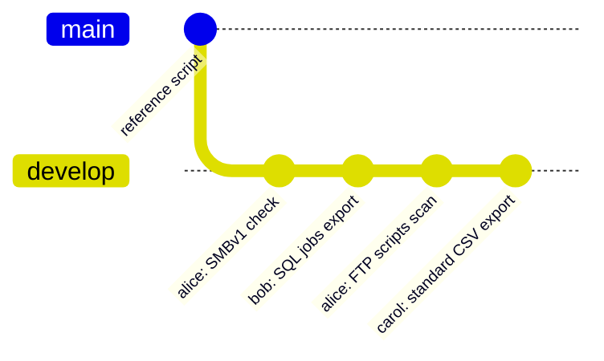
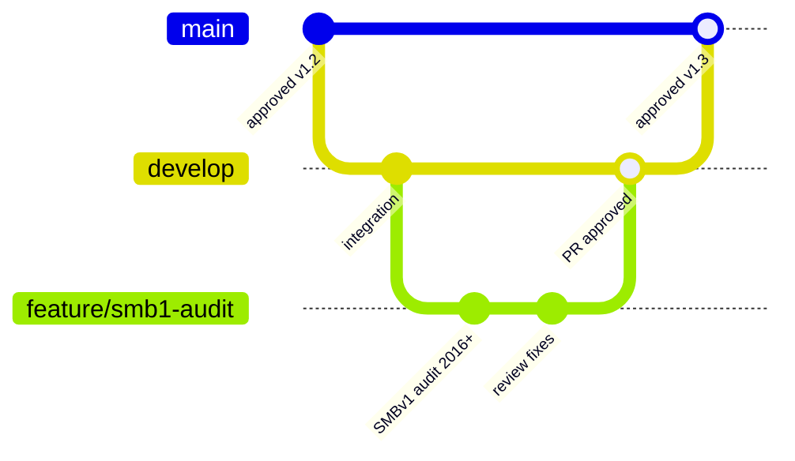

<p align="center">
  
</p>

<p align="center">
  <a href="#1-bring-your-own-script"><b>Bring your own script</b></a> &nbsp;·&nbsp;
  <a href="#2-repository-layout"><b>Repository</b></a> &nbsp;·&nbsp;
  <a href="#3-set-up-vs-code"><b>VS Code setup</b></a> &nbsp;·&nbsp;
  <a href="#4-daily-workflow-on-develop"><b>Daily workflow</b></a> &nbsp;·&nbsp;
  <a href="#5-github-copilot"><b>Copilot</b></a> &nbsp;·&nbsp;
  <a href="#6-checklist-before-you-push"><b>Checklist</b></a> &nbsp;·&nbsp;
  <a href="README.md"><b>Governance guide</b></a>
</p>

<p align="center"><sub>Companion to the <a href="README.md">migration governance guide</a> · for sysadmins and DBAs who write or run discovery and migration scripts</sub></p>

> [!IMPORTANT]
> **Use the script you know. Share it in the team repository.**
> Your own script is welcome, as long as it follows the five rules in [section 1](#1-bring-your-own-script) and is pushed to the repository before it runs on a production server.

<p align="center"></p>

## 1. Bring your own script

Many of us already have discovery scripts that work. There's no need to rewrite them. What the migration needs is **comparable output**, **safe execution** and a record of **what ran where**.

### The five rules

| # | Rule | Why |
|:-:|---|---|
| **1** | **Standard output.** Produce the standard file names, CSV columns and flag summary ([governance guide §3.2–3.3](README.md#32-output-naming-and-storage)) | Results can be compared across servers and bundles, and the summary is what gets reviewed |
| **2** | **Checklist coverage.** Collect the Discovery checklist items for your role, whatever the tool | Nothing is missed (SMBv1, FTP, monthly jobs, …) |
| **3** | **Read-only.** Discovery scripts never change anything on the server | Safety on production |
| **4** | **No secrets.** No passwords in scripts, config files or output. Credentials come from the vault or `Get-Credential` at run time | Security requirement |
| **5** | **In the repository first.** The version that runs on production is in the repository, and its version or commit is recorded in the summary | Answers "what ran on this server, with admin rights?" |

How a script is written (style, structure, language, tool) is **up to its author**.

> [!TIP]
> **Already have a script?** Usually it only needs an **export step at the end** that writes the standard CSV names and the flag summary. That's often a short job, and Copilot can help ([section 5](#5-github-copilot)).
>
> **Don't have one?** Use the **reference script** in `discovery/reference/`. It's optional; it covers 2003 to 2019, and runs on PowerShell 2.0 with the newer cmdlets used only where they exist.

### Script header

Every script starts with a short comment-based help block, so anyone can see what it does, what it needs and who to ask:

```powershell
<#
.SYNOPSIS
    Server discovery: services, tasks, shares, SMBv1, FTP.
.DESCRIPTION
    Read-only. Writes <SERVER>_<area>_<yyyyMMdd>.csv and <SERVER>_SUMMARY_<yyyyMMdd>.csv
    to the output folder given in -OutputPath.
.PARAMETER ComputerName
    Server to discover. Defaults to the local computer.
.PARAMETER OutputPath
    Folder for the CSV files.
.NOTES
    Author   : <name>
    Version  : 1.3.0
    Requires : PowerShell 2.0+ (runs on 2008 R2); remote WMI for 2003
    Changes  : 1.3.0 - added SMBv1 client check
.EXAMPLE
    .\Get-ServerDiscovery.ps1 -ComputerName APP01 -OutputPath D:\Discovery
#>
```

<p align="center"></p>

## 2. Repository layout

One repository for the whole team. Each author keeps their own folder, so nobody's work is overwritten and credit stays visible.

```text
migration-scripts/
├── README.md                         what's here, link to this guide
├── .github/
│   └── copilot-instructions.md       team rules Copilot follows (see 5.4)
├── .gitignore                        keeps output and secrets out of Git
├── discovery/
│   ├── reference/                    optional reference script (2003–2019)
│   ├── <author>/                     each person's own scripts
│   │   ├── Get-ServerDiscovery.ps1
│   │   └── README.md                 one paragraph: what it covers, how to run it
│   └── sql/
│       └── <author>/                 DBA scripts (T-SQL, dbatools)
├── common/
│   └── Export-StandardOutput.ps1     shared export step for the standard CSVs
└── checks/
    └── Test-DiscoveryOutput.ps1      checks a SharePoint folder for missing files or columns
```

**`.gitignore`**: discovery output and credentials never go to Git.

```gitignore
# Discovery output belongs in SharePoint, not Git
*.csv
*.xlsx
output/
# Credentials and local settings
*.cred
*.secret
.env
.vscode/settings.json
```

<p align="center"></p>

## 3. Set up VS Code

You install it once, and it takes about 15 minutes. VS Code runs on your **admin workstation**, not on the legacy servers.

### 3.1 Install

1. Install **Visual Studio Code** and **Git for Windows** from the company software portal.
2. Open VS Code, go to **Extensions** (`Ctrl+Shift+X`) and install:

| Extension | What it does |
|---|---|
| **PowerShell** (Microsoft) | Syntax, IntelliSense, debugging, and **PSScriptAnalyzer** warnings as you type |
| **GitHub Copilot** | AI suggestions and Copilot Chat (see [section 5](#5-github-copilot)) |
| **SQL Server (mssql)** (Microsoft) | For DBAs: run T-SQL against an instance from VS Code |
| **GitLens** (optional) | Shows who changed each line and when |

3. Tell Git who you are, once. In the terminal (`` Ctrl+` ``):

```powershell
git config --global user.name  "First Last"
git config --global user.email "first.last@company.com"
```

### 3.2 Clone the repository

1. `Ctrl+Shift+P`, then **Git: Clone**, then paste the repository URL.
2. Choose a local folder, for example `C:\Repos`, and click **Open**.
3. In the bottom-left corner, click the branch name and choose **`develop`**.

### 3.3 Where things are

| Shortcut | Opens |
|---|---|
| `Ctrl+Shift+E` | Explorer (files) |
| `Ctrl+Shift+G` | **Source Control**: changes, commit, push |
| `` Ctrl+` `` | Terminal (PowerShell) |
| `Ctrl+Shift+P` | Command palette (every command) |
| `F5` / `F8` | Run the script / run the selected lines |
| `Ctrl+I` | Copilot inline chat |
| `Ctrl+Alt+I` | Copilot Chat panel |

> [!NOTE]
> **PowerShell 2.0 targets.** VS Code runs your script with the workstation's PowerShell 5.1 or 7. That's fine for editing and syntax checks, but **test on a real 2008 / 2008 R2 server, or a lab copy**, before running it in a bundle. A cmdlet that works on your workstation may not exist there.

<p align="center"></p>

## 4. Daily workflow on `develop`

For now, the team works on **one branch: `develop`**. Everyone pulls from it and pushes to it. That keeps things simple, as long as everyone **pulls before starting** and **pushes small changes often**.



### 4.1 The loop

| Step | In VS Code | Equivalent command |
|---|---|---|
| **1. Pull** before you start | Source Control → `...` → **Pull**, or the sync icon in the status bar | `git pull` |
| **2. Write and test** | Edit; run with `F5` against a test server | |
| **3. Review** your changes | Source Control: click each file to see a side-by-side diff | `git diff` |
| **4. Commit** | Type a message, then **Commit** (`Ctrl+Enter`) | `git commit -am "..."` |
| **5. Push** | **Sync Changes** (pull, then push) | `git pull` then `git push` |

### 4.2 Commit messages

Short, in the form `<area>: what changed`, so the history reads like a changelog:

```text
discovery: add SMBv1 client check for 2012+
sql: export Agent jobs with monthly schedules
common: summary file now includes the script version
fix: Get-ServerDiscovery failed on 2003 without PowerShell
```

> [!TIP]
> In Source Control, the **sparkle button** next to the message box makes Copilot write a commit message from your changes. Check it before committing.

### 4.3 If two people changed the same lines

VS Code shows a **merge conflict** when you pull. Open the file and, for each highlighted block, choose **Accept Current**, **Accept Incoming** or **Accept Both**. Then commit and push. If you're unsure, ask the other author; their name is in the conflict block.

Separate folders per author make conflicts rare.

### 4.4 Later: feature branches and pull requests

When the team is comfortable with `develop`, the next step is short-lived branches merged through a **pull request**. One colleague reviews before the change reaches `develop`, and `main` holds the approved versions that run in bundles:



This isn't required yet. It's listed here so the team knows where things are heading.

<p align="center"></p>

## 5. GitHub Copilot

The company has approved **GitHub Copilot** for enterprise use. It runs inside VS Code, and you sign in with your **company account**.

### 5.1 Sign in

1. Install the **GitHub Copilot** extension (see 3.1).
2. Click the **Copilot icon** in the status bar, then **Sign in**, and use your **company GitHub account** (SSO).
3. The Copilot icon turns active. If it says you have no access, ask the tech lead to request a seat.

### 5.2 Four ways to use it

| Mode | How | Good for |
|---|---|---|
| **Inline suggestions** | Just type. Grey text appears: `Tab` accepts it, `Esc` dismisses it, `Alt+]` shows the next suggestion | Repetitive code: CSV columns, registry checks, parameter blocks |
| **Inline chat** | Select code, press `Ctrl+I`, and ask | "Make this PowerShell 2.0 compatible" |
| **Chat panel** | `Ctrl+Alt+I`; add files with `#file` or by dragging them in | Questions about a whole script; explanations |
| **Agent mode** | In the Chat panel, choose **Agent**. Copilot edits several files and shows each change for you to accept or reject | Larger changes, such as adding the standard export to several scripts |

Useful **slash commands** in chat: `/explain` (explain the selected code), `/fix` (propose a fix for an error), `/doc` (write the comment-based help), `/tests` (write Pester tests).

### 5.3 Prompts that work well for this project

```text
/explain  (on a colleague's script you need to run)

Make this script compatible with PowerShell 2.0. No Get-CimInstance,
no ConvertTo-Json, no [PSCustomObject]. Keep it read-only.

Add an export step that writes the results to <SERVER>_services_<yyyyMMdd>.csv
with columns Name, DisplayName, StartName, StartMode, State.

Add a check: if a service runs as a named account, add an AMBER row to the
flag summary with Area = "Identity".

Write comment-based help for this script using our header format.

Convert this T-SQL to also work on SQL Server 2000 (sysprocesses, no DMVs).
```

### 5.4 Team rules for Copilot: `.github/copilot-instructions.md`

Copilot in VS Code **automatically reads** `.github/copilot-instructions.md` from the repository and follows it in every chat. Putting the five rules there means Copilot proposes compliant code without being reminded:

```markdown
# Copilot instructions for migration-scripts

- Scripts run on Windows Server 2003 to 2019. Unless a script says otherwise,
  write PowerShell 2.0 compatible code: Get-WmiObject (not CIM), Export-Csv
  (not ConvertTo-Json), New-Object PSObject (not [PSCustomObject]).
  Newer cmdlets only behind: if ($PSVersionTable.PSVersion.Major -ge 3).
- Discovery scripts are read-only. Never write to the registry, services,
  files outside -OutputPath, or SQL.
- Never put credentials in code. Use Get-Credential or the vault.
- Output: <SERVER>_<area>_<yyyyMMdd>.csv and <SERVER>_SUMMARY_<yyyyMMdd>.csv
  with columns Server, Area, Item, Flag, Detail, Owner, Decision, DecidedBy, Date.
- Every script starts with comment-based help (.SYNOPSIS, .DESCRIPTION,
  .PARAMETER, .NOTES with Author, Version, Requires, Changes, .EXAMPLE).
- T-SQL must say which SQL Server versions it supports (2000 has no DMVs).
```

### 5.5 Rules for using Copilot

> [!WARNING]
> **You're responsible for every line you commit, whether Copilot wrote it or not.**
> - **Read and test** every suggestion before you commit. Copilot doesn't know which cmdlets exist on a 2008 server, and it can write code that looks right but isn't.
> - **Don't paste secrets** into the chat: no passwords, connection strings with credentials, or keys.
> - **Don't paste real discovery data** (server lists, IPs, user names, file listings) unless the company Copilot policy allows it. Use made-up examples such as `APP01` or `10.0.0.10`.
> - Follow the **company's Copilot policy**. The tech lead has the link.

<p align="center"></p>

## 6. Checklist before you push

- [ ] Pulled `develop` first
- [ ] Script header filled in, and the version number bumped if the behaviour changed
- [ ] Still **read-only**; no secrets anywhere
- [ ] Produces the **standard output** (checked with `checks/Test-DiscoveryOutput.ps1` on a test run)
- [ ] Tested on the **oldest OS or SQL version** it claims to support
- [ ] No warnings from PSScriptAnalyzer (shown in VS Code's **Problems** panel, `Ctrl+Shift+M`), or each one understood
- [ ] No output files or credentials staged (check the Source Control list)
- [ ] Clear commit message: `<area>: what changed`

<p align="center"></p>

<p align="center"><sub>Scripts &amp; VS Code · companion to the migration governance guide · improve this page the same way as the scripts: change it and push to <code>develop</code></sub></p>
