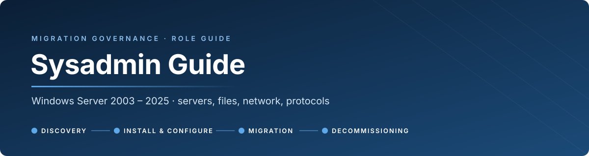
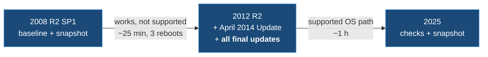
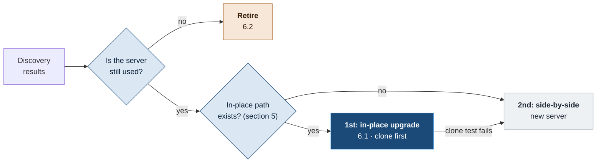

  

  <a href="#1-supported-vs-works-but-not-supported"><b>Supported vs works</b></a> &nbsp;·&nbsp;
  <a href="#2-your-responsibilities"><b>Responsibilities</b></a> &nbsp;·&nbsp;
  <a href="#3-hand-offs-with-the-dba"><b>Hand-offs</b></a> &nbsp;·&nbsp;
  <a href="#4-target-platform"><b>Target platform</b></a> &nbsp;·&nbsp;
  <a href="#5-windows-in-place-upgrade-paths"><b>In-place paths</b></a> &nbsp;·&nbsp;
  <a href="#6-options-after-discovery"><b>In-place · retire</b></a> &nbsp;·&nbsp;
  <a href="#7-tasks-by-phase"><b>Tasks by phase</b></a> &nbsp;·&nbsp;
  <a href="README.md"><b>Big picture</b></a>

Role guide for sysadmins · the <a href="README.md">governance guide</a> is the big picture; this page is <b>what the sysadmin owns</b> · the SQL side is in the <a href="DBA.md">DBA guide</a>

> [!IMPORTANT]
> **The sysadmin owns everything around SQL Server:** the server, the OS, disks, network, DNS, firewall, certificates, file shares, FTP flows and legacy protocols.
> **The DBA owns everything inside the instance.** You work together, but each side signs for its own part.

## 1. Supported vs works but not supported

These two words decide how a path is used: directly, or proven on a cloned VM first.

| | **SUPPORTED** | **WORKS, BUT NOT SUPPORTED** |
|---|---|---|
| **Meaning** | **Microsoft documents it:** the OS version is in support, the upgrade path is in Microsoft's table, and the software on it is supported on that OS | **It runs, and we proved it in the lab, but Microsoft doesn't document it** (or flags it as incompatible) |
| **Fixes and security updates** | **Yes** | **No.** Out-of-support OS, or an app the OS vendor won't fix |
| **Microsoft support case** | **Accepted** | **Can be refused** |
| **Approval** | **Normal gate** | **Normal gate. No exception, not a blocker**: the path is **always run on a cloned VM first** |
| **Can it be the end state?** | **Yes** | **No. A step on the way to a newer, supported platform** |
| **Who carries the risk** | Shared with the vendor | **Us alone**, which is why it's proven on a clone first |

> [!IMPORTANT]
> **Every migration ends on a newer, supported version.** An unsupported step on the way (for example 2008 R2 → 2012 R2) is allowed **when it has run on a cloned VM of the real server first**. **"LAB OK"** shows the path works in general; **the clone** shows it works for this server. The sysadmin **clones and isolates** the VM: [governance §2.7, clone-first](README.md#clone-first-procedure).

**On the sysadmin side, it typically looks like this:**
- **The upgrade path is supported, but what runs on it isn't.** Windows 2012 R2 → 2025 is a **supported OS upgrade**, but setup flags SQL Server 2005 as an incompatible application (a soft block). The OS is supported; **the server as a whole isn't**.
- **A path that Microsoft no longer documents.** Windows 2008 R2 SP1 → 2012 R2 isn't in Microsoft's current upgrade table any more. **It worked in our lab**, but treat it as *works, but not supported*.
- **An out-of-support OS** (2003, 2008, 2008 R2, 2012 R2) **without ESU** gets no security updates at all. **As a step on the way, it is fine (clone first); as an end state, it is not.**
- **Legacy protocols left on** (SMBv1, TLS 1.0, NTLMv1): Windows still has the switches, but **our policy is to turn them off**. Leaving them on needs an exception ([governance §2.6](README.md#26-legacy-protocols-and-insecure-settings)).

## 2. Your responsibilities

**A** = accountable (signs for it), **R** = does the work, **C** = consulted. The full RACI with every role is in the [governance guide §2.3](README.md#23-raci-for-all-phases).

| Phase | Sysadmin is **A** for | Sysadmin is **R** for | Sysadmin is **C** for |
|---|---|---|---|
| **1 · Discovery** | Server discovery script and output; server and protocol flags | Files, shares and unused data; legacy protocols (SMBv1, FTP, TLS, NTLMv1); connection capture at OS level | SQL discovery |
| **2 · Install & configure** | **Target server build and hardening** | Smoke test (server side) | SQL install; firewall and certificate requests (Security / Network own them) |
| **3 · Migration** | OS-level cut-over: DNS, aliases, file shares, MFT flows, scheduled tasks | Rehearsal; cut-over and rollback plan (server side) | Data migration (DBA) |
| **4 · Decommissioning** | **Server removal from every system** | Quiet-period or scream-test monitoring; carrying out the data decision for file shares | Instance decommissioning (DBA) |

**What the sysadmin signs at each gate**

| Gate | Sysadmin signature covers |
|---|---|
| **Gate 1** | Server summary reviewed; every server and protocol RED flag decided; FTP flows listed for MFT; OS path chosen (section 5) |
| **Gate 2** | Server built to standard; legacy protocols off (or an exception logged); agents installed; MFT flows set up |
| **Gate 3** | DNS and aliases switched; file shares and scheduled tasks moved; MFT flows tested with partners; monitoring green |
| **Gate 4** | Quiet period clean; final backup kept; removed from AD, DNS, DHCP, firewall, monitoring, backup, AV, patching, CMDB |

## 3. Hand-offs with the DBA

Most delays happen **between** the two roles. Ask early, using this list.

| Sysadmin needs from the DBA | DBA needs from the sysadmin |
|---|---|
| **SQL port(s)** and Browser need, for the firewall rules | Target server built, with **disk layout for SQL**: data, log, tempdb and backup volumes, 64 KB allocation unit |
| **AV exclusions** for data, log and backup files and `sqlservr.exe` | **Service accounts** or gMSAs created, passwords in the vault, with **instant file initialization** and **lock pages in memory** rights |
| **Backup** schedule and retention for the agent | Backup agent installed; backup share reachable |
| Which **apps and servers connect** to SQL (from the capture), for the dependency list | Firewall rules for 1433 / named instance ports |
| **Go / no-go** on the SQL side before the DNS switch | **DNS alias switch** at the agreed time in cut-over |
| **TLS level** needed by SQL clients (legacy 2005 clients need TLS 1.0) | TLS certificate for SQL encryption |
| Confirmation that **databases are offline** before power-off | Server kept powered on during the quiet period |

## 4. Target platform

| | **Default** | Why |
|---|---|---|
| **OS for a new build** | **Windows Server 2025** (2022 if the application vendor requires it) | Longest support. 2025 supports SQL 2019, 2022 and 2025 (see the [DBA matrix](DBA.md#4-sql-server-on-windows-server)) |
| **1st choice: in-place upgrade** | **Whenever a path exists** (section 5). **Always run on a cloned VM first** ([clone-first](README.md#clone-first-procedure)) | Same server, name, IP and data: fewer dependencies to move. The clone proves the path for this server; production gets a snapshot before each hop |
| **After an in-place upgrade** | **Harden** after the last hop: SMBv1 off, TLS 1.2+ only, NTLMv1 refused, old roles and agents reviewed | An in-place upgrade **keeps every old setting**, including the insecure ones ([governance §2.6](README.md#26-legacy-protocols-and-insecure-settings)) |
| **2nd choice: side-by-side** | New server, then move apps and data. When **no in-place path exists** (2003), or the **clone test fails** | Clean build. The source stays untouched as the rollback |

> [!NOTE]
> Check the SQL version before you choose the OS. **SQL 2017 isn't supported on Windows 2025, and SQL 2016 isn't supported on 2022.** Agree the OS and SQL pair with the DBA at Gate 1.

## 5. Windows in-place upgrade paths

### 5.1 Paths

| From | To (in place) | Status |
|---|---|---|
| **2003** | Nothing modern | **No path.** Side-by-side only |
| **2008** (x64) | 2012 | Older Microsoft guidance; no longer in the current table. Try it on a clone (then 2012 → 2016 → 2025); side-by-side if it fails |
| **2008 R2 SP1** | 2012 R2 | **Works, but not supported** (no longer in Microsoft's current table). **LAB OK** |
| **2012** | 2012 R2, 2016 | Supported |
| **2012 R2** | 2016, 2019, **2025** | **Supported.** Not to 2022 (not supported). 2012 R2 → 2025 is **LAB OK** |
| **2016** | 2019, 2022, 2025 | Supported |
| **2019** | 2022, 2025 | Supported |
| **2022** | 2025 | Supported |

Source: Microsoft, [Windows Server upgrade paths](https://learn.microsoft.com/en-us/windows-server/get-started/install-upgrade-migrate). Since 2025, a non-clustered server can jump **up to four versions**; earlier versions allow two. Rules that always apply:
- same edition or higher;
- same install language;
- x64 to x64;
- **evaluation media can't upgrade a licensed server**;
- disable NIC teaming first;
- each hop needs its own licence.

### 5.2 Lab-proven chain: 2008 R2 SP1 → 2012 R2 → 2025

**PARTLY NOT SUPPORTED. Proven in our lab, with SQL 2005 and a live application on the server.** The SQL side and its conditions are in the [DBA guide §5.3](DBA.md#53-lab-proven-interim-path-keep-sql-upgrade-the-os-under-it).

**What the lab taught us.** Each item stopped or broke an upgrade at least once:

| # | Lesson |
|:-:|---|
| 1 | **Check the ISO first:** authentic, **not Evaluation** (`ei.cfg` with `Channel=eval` is a blocker), same edition and language |
| 2 | 2008 R2 needs **SP1** before going to 2012 R2 |
| 3 | 2008 R2 → 2012 R2 unattended: the answer file needs `ImageInstall` **and** `InstallTo` (the existing OS partition). Run setup **on the console**, because the app-compatibility page (SQL 2005) waits for **Confirm** |
| 4 | **Before going to 2025, patch 2012 R2 fully** to its last public updates (SSU **KB5032308** and rollup **KB5031419**). With only the 2014 updates, the 2025 setup **crashed** (`0xC190011F`) |
| 5 | 2025 needs a CPU with **x86-64-v2** (on a VM, set the CPU type before the upgrade) |
| 6 | Keep **40 GB+ free** on C: before each hop; grow the disk if needed |
| 7 | Activation is reset after each hop. Plan **KMS or MAK** |
| 8 | After the 2025 upgrade, **RDP didn't listen** until one more restart. **Check RDP explicitly** |
| 9 | With pending updates, shut down **from inside Windows**; the hypervisor's shutdown timed out |
| 10 | **Snapshot before each hop**, and keep it until the app owner confirms |

Full runbook, commands and logs: [legacy-migration runbook](../legacy-migration/README.md).

## 6. Options after Discovery

Discovery ends with **one of three options** for each server, decided at Gate 1 ([governance §1.10](README.md#110-disposition-migrate-consolidate-or-retire)):

### 6.1 In-place upgrade, step by step

**What it is:** Windows is upgraded **on the same server**: same name, IP, data, shares, scheduled tasks and installed software. Nothing has to be moved, which is why it's the first choice. **The sysadmin runs the OS hops; the DBA checks SQL before and after each hop.**

| # | Step | Sysadmin | DBA |
|:-:|---|---|---|
| **1** | **Prepare** | Check the path (5.1), media (not Evaluation, same edition and language), licences, free disk (40 GB+), CPU (x86-64-v2 for 2025). Patch the source fully | Confirm the SQL version will run on each OS hop ([DBA matrix](DBA.md#4-sql-server-on-windows-server)). Full backups of all databases, system databases included |
| **2** | **Clone and isolate** | Clone the production VM; isolate it (no production network) | |
| **3** | **Rehearse on the clone** | Run every hop, timed. Note every prompt and problem | After each hop: SQL services up, error log clean, `DBCC CHECKDB`, app test |
| **4** | **Record the runbook** | Steps, timings, problems and fixes on the server page | SQL checks and their results on the server page |
| **5** | **Change window on production** | **Snapshot before each hop.** Run the same steps | Final backups before the first hop; the same SQL checks after each hop |
| **6** | **Harden after the last hop** | SMBv1 off, TLS 1.2+ only, NTLMv1 refused, old roles and agents reviewed. Activation (KMS or MAK). RDP checked | Confirm the SQL clients still connect after the TLS change (SQL 2005 clients need TLS 1.0) |
| **7** | **If SQL can't stay** | | Old SQL version on the new OS (e.g. SQL 2005 on 2025): install a new SQL 2022 / 2025 instance on the same server and restore the databases into it ([DBA §6.1](DBA.md#61-in-place-upgrade-step-by-step)) |
| **8** | **Accept and clean up** | Keep the snapshots until the app owner accepts (Gate 3), then delete them. Remove `Windows.old` with Disk Cleanup | |

**Rollback:** revert to the snapshot taken before the failed hop. The clone run tells you how long each hop takes, so the change window is sized from it.

> [!NOTE]
> **An in-place upgrade doesn't create a new server, so there's no Phase 2 build** in the usual sense. Phase 2 becomes **preparing the source** (step 1), and the hardening in step 6 replaces the standard build's security settings.

### 6.2 Retire: when Discovery shows the server isn't used

If nobody and nothing uses the server any more, it **isn't migrated at all**. It goes straight to Phase 4 on the **retire-only path** ([governance, retire-only path](README.md#retire-only-path)).

**Evidence the sysadmin brings to Gate 1:**

| Check | "Not used" looks like |
|---|---|
| Inbound connections during the capture week | **None**, apart from monitoring, backup and admin tools |
| SMB sessions and open files | **None** on the shares |
| Interactive and service logons (Security log) | Only admins and service accounts |
| FTP logs | **No transfers** in the retained logs |
| Scheduled tasks | Only maintenance (cleanup, defrag, backup); no business jobs, or the jobs' output isn't used by anyone |
| IIS logs (if any) | No requests, or only health checks |
| DNS aliases pointing to it | None, or the systems that use them confirmed retired |
| Monthly or quarterly jobs | Each one checked with its owner: not needed |

> [!IMPORTANT]
> **The sysadmin brings the evidence; the app owner decides.** "No connections in a week" isn't proof on its own. The app owner confirms in writing that the service is no longer needed and decides what happens to the data.

**Sysadmin tasks on the retire-only path:**
- [ ] Announce the retirement date and a contact to the users and teams found in Discovery
- [ ] Carry out the data decision for the file shares (archive, hand over, or delete under the retention policy), after a last full backup
- [ ] **Scream test:** stop the services or disable the NIC, so it can be undone in minutes. **At least 4 weeks, including a month-end**
- [ ] If someone is affected: re-enable, record the missed dependency, and go back to Gate 1
- [ ] If nobody is affected: wait for the DBA's confirmation (if SQL is on it), power off, then the removal checklist (section 7, Phase 4)

## 7. Tasks by phase

### Phase 1 · Discovery

Details and commands: [governance §1.2 – 1.5](README.md#12-server-platform-identity-and-software).

- [ ] Run the server discovery script (yours or the reference one); output in `Migration/<BUNDLE>/<SERVER>/1-Discovery/`
- [ ] Platform, identity, software, roles, services, **scheduled tasks** (monthly or quarterly ones listed with an owner)
- [ ] Network: IPs, DNS aliases, `hosts` entries, listening ports, **connection capture** for the Discovery week
- [ ] Certificates, backup, monitoring and AV agents
- [ ] **Legacy protocols:** SMBv1 (server, clients, as a client), TLS, NTLMv1, telnet, SNMP. All documented
- [ ] **FTP:** every flow, its partner, where the files land on the file shares, and what processes them. Listed for **MFT**
- [ ] **Files and shares:** sizes, data by age, open-file sessions, orphaned home folders, risky file types
- [ ] Server flags written to the summary file; OS path chosen with the DBA (section 4); sign the Gate 1 part

### Phase 2 · Install & configure

- [ ] Server from the **standard build**, patched, in the right OU
- [ ] Disk layout to standard, including the **SQL volumes** the DBA asked for (64 KB allocation unit)
- [ ] Service accounts or gMSAs; passwords in the **vault**; IFI and lock pages in memory rights for SQL
- [ ] Roles and features from Discovery (IIS, .NET 3.5, MSMQ, …)
- [ ] **SMBv1 off, TLS 1.2+ only, NTLMv1 refused**, unless an exception is logged
- [ ] **MFT flows** set up for every FTP flow found
- [ ] Certificates (SHA-256, 2048-bit+); firewall rules requested from Security / Network
- [ ] Backup, monitoring, AV/EDR (with the DBA's exclusions), patching agents
- [ ] Scheduled tasks prepared but **disabled**
- [ ] Service recovery actions on critical services (lab finding: they aren't set by default for old software)

### Phase 3 · Migration

- [ ] **Clone and isolate** the production VM, then **rehearse** the server-side steps on it, timed ([clone-first](README.md#clone-first-procedure))
- [ ] File shares: **robocopy** with `/COPYALL`, a preliminary pass days before, then a final delta during the freeze
- [ ] Scheduled tasks enabled on the target, disabled on the source
- [ ] **MFT flows** switched over and tested with each partner; FTP service on the old server stopped
- [ ] **DNS and aliases** switched after the DBA's go; the old name kept as a CNAME only if the app needs it
- [ ] Every Discovery dependency tested: scanners, MFT partners, interfaces, reports
- [ ] Legacy-protocol flags closed, or covered by a logged exception
- [ ] Monitoring green for 48 h

### Phase 4 · Decommissioning

- [ ] **Quiet period** (or scream test for a retire): connection capture still running on the old server, **including a month-end**
- [ ] File-share data decision carried out: archive, hand over or delete, **signed by the data owner**
- [ ] Wait for the DBA's confirmation that the databases are offline and backed up
- [ ] Server **powered off, not deleted**, for the agreed wait; final backup kept, with a restore test
- [ ] Removed from **AD, DNS, DHCP, firewall, monitoring, backup, AV/EDR, patching, CMDB**; licences reclaimed; service accounts disabled; certificates revoked
- [ ] VM deleted or hardware disposed of, disks wiped

Sysadmin guide · part of the <a href="README.md">migration governance</a> · lab evidence in <a href="../legacy-migration/README.md">legacy-migration</a>

